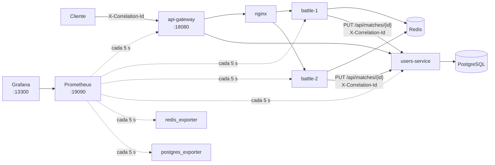
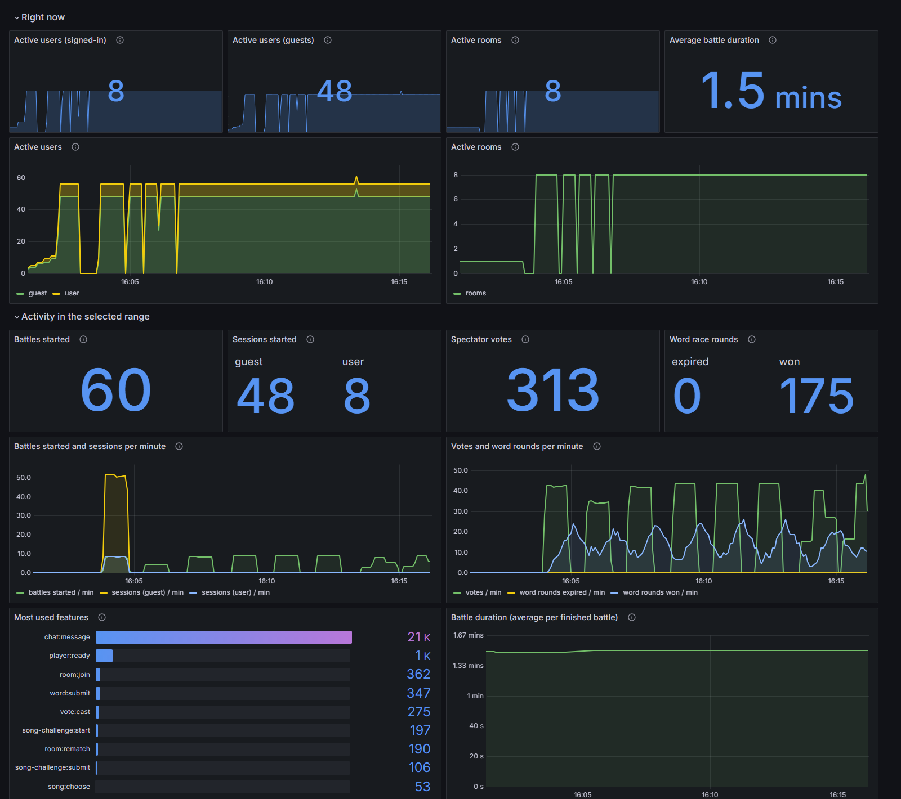
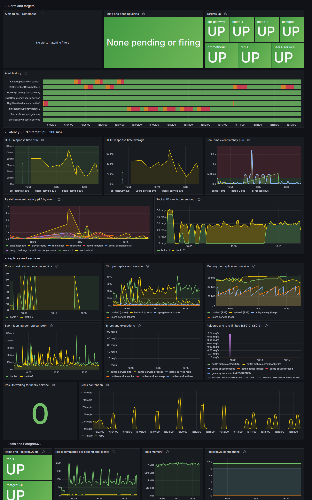
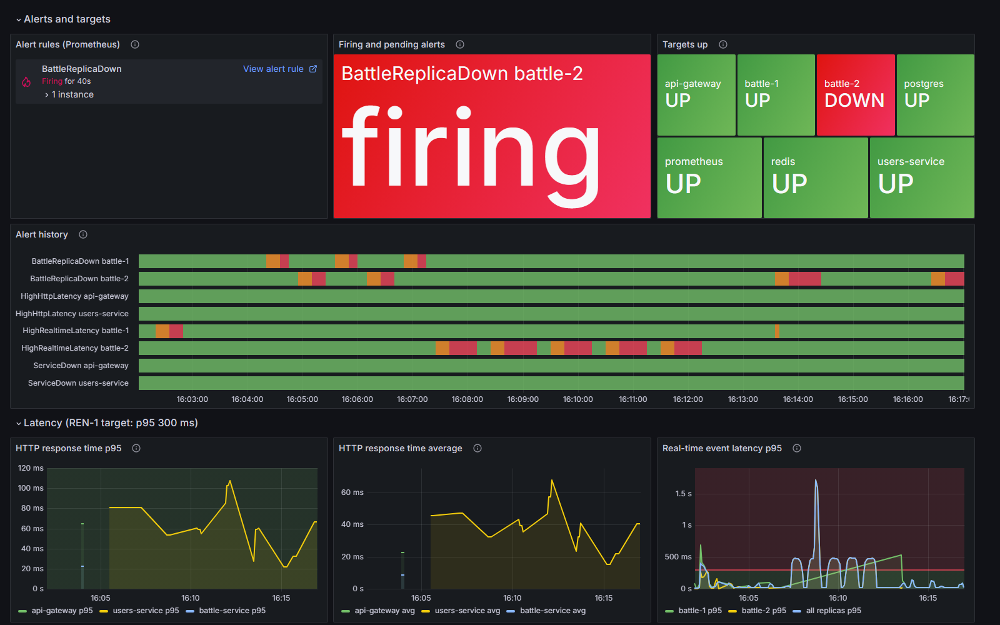
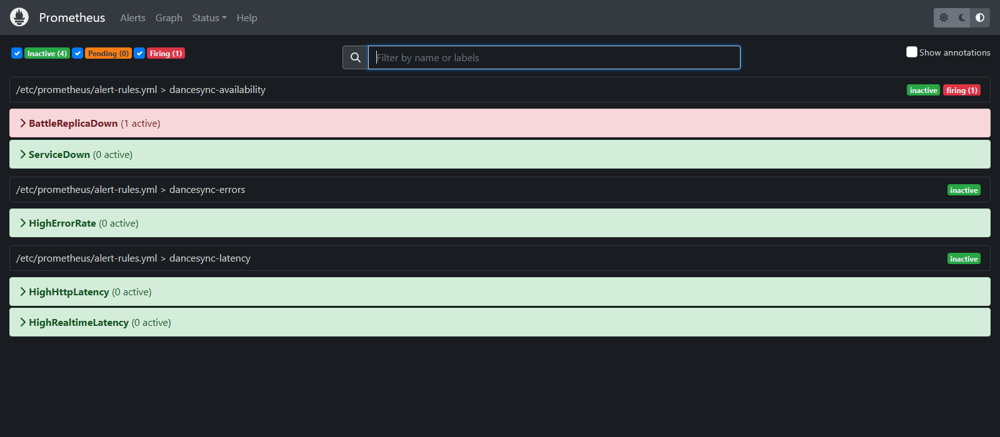

# OBS-1: Observabilidad

Implementación y evidencia del escenario de calidad OBS-1 de DanceSync (Squad Héroes, Arquitecturas de Software 2026-2).

| | |
|---|---|
| Estado | **Implementado y verificado en el entorno local.** Prometheus y Grafana corren solo en local (ver [Azure](#azure)) |
| Repositorio | `DanceSync_BackEnd` (`api-gateway`, `users-service`, `battle-service`, `observability`, `load-tests`), rama `feat/observabilidad` |
| Alcance | Logs JSON con identificador de correlación en los tres servicios, métricas Prometheus, dos tableros en Grafana, reglas de alerta y los scripts que miden las tres medidas de respuesta |
| Contrato | [PRD-OBS-1](../prd/PRD-OBS-1-observability.md) |

## Contenido

1. [El escenario y cómo se cumple](#1-el-escenario-y-cómo-se-cumple)
2. [Cómo funciona](#2-cómo-funciona)
3. [Qué se implementó](#3-qué-se-implementó)
4. [Cómo ejecutarlo](#4-cómo-ejecutarlo)
5. [Verificación y evidencia](#5-verificación-y-evidencia)
6. [Hallazgos](#6-hallazgos)
7. [Limitaciones](#7-limitaciones)
8. [Azure](#azure)

## 1. El escenario y cómo se cumple

| Parte | OBS-1 |
|---|---|
| Fuente | Equipo de desarrollo y operación, y el dueño del negocio |
| Estímulo | Durante una sesión de juego el servicio se degrada: sube la latencia, crecen los errores o cae una réplica |
| Artefacto | API Gateway, battle-service, users-service, Redis y PostgreSQL, con sus logs, métricas y dos tableros (negocio y técnico) |
| Entorno | Operación con usuarios reales o durante una prueba de carga |
| Respuesta | Logs JSON con un identificador de correlación generado por el gateway y propagado a los demás servicios y a los eventos de Socket.IO; métricas en formato Prometheus en cada servicio, recolectadas por Prometheus y mostradas por Grafana; una regla de alerta se dispara ante la degradación |
| Medida de respuesta | Métricas visibles con a lo sumo **15 s** de retraso; degradación detectada y alertada en **menos de 1 min**; un evento trazable a través de los **tres servicios** con su identificador |

| Lo que pide OBS-1 | Resultado | Evidencia |
|---|---|---|
| Métricas visibles en ≤ 15 s | 20 muestras: **p50 1,1 s, p95 4,7 s, máximo 5,0 s** hasta Prometheus. Con el refresco de Grafana (5 s), el peor caso en pantalla es 10,0 s | `obs-metrics-lag-*.json` |
| Alerta en < 1 min | Réplica caída (`BattleReplicaDown`), 5 corridas: **23,5 a 24,5 s**. Latencia alta (`HighRealtimeLatency`, Redis ralentizado), 5 corridas: **28,2 a 29,7 s**. Todas con 56 usuarios conectados | `obs-alert-time-*.json` |
| Trazar un evento por los 3 servicios | El identificador `obs1-trace-1794776096314` aparece en **api-gateway (4 líneas), battle-service (25, en las dos réplicas) y users-service (2)**, y termina en la línea de users-service para `PUT /api/matches/{id}` de la batalla | `obs-trace-*.json` |

### Tácticas aplicadas

| Táctica | Cómo se aplica |
|---|---|
| Detectar fallas: monitor | Prometheus recolecta cada servicio, cada réplica y los exportadores de Redis y PostgreSQL cada 5 s y evalúa las reglas de alerta |
| Detectar fallas: heartbeat | `up` por objetivo: una réplica que no responde a la recolección es `up == 0` y dispara `BattleReplicaDown` |
| Probabilidad de prueba: registrar y observar el estado | Logs JSON con `correlationId`, métricas de negocio y técnicas, y dos tableros versionados |

## 2. Cómo funciona



- **Un identificador por petición.** El gateway conserva un `X-Correlation-Id` válido o genera uno, lo devuelve y lo reenvía en todas las rutas, incluido el handshake de Socket.IO. battle-service lo guarda en cada conexión, lo escribe en cada línea de evento y guarda el de `battle:start` en la batalla: las líneas de rondas y fin (que dispara un temporizador) y el envío del resultado a users-service llevan ese mismo identificador.
- **Métricas internas.** battle-service sirve `/metrics` en el puerto 9464 y los servicios Java `/actuator/prometheus` en su puerto de gestión (9081 y 9082). Ningún puerto de métricas está publicado ni enrutado por el gateway o nginx.
- **Una réplica, un objetivo.** Prometheus recolecta `battle-1:9464` y `battle-2:9464` por separado. Si una réplica cae, su `up` vale 0 aunque nginx siga atendiendo con la otra.
- **Alertas en Prometheus, estados en Grafana.** Las reglas están en `observability/prometheus/alert-rules.yml`. El tablero técnico muestra la lista de reglas, las alertas activas y su historial; no hay canal de notificaciones.

## 3. Qué se implementó

El código de logs y métricas de los servicios está en los commits anteriores de la rama (ver el PRD). Esta parte agrega el entorno, los tableros, las alertas y las mediciones.

### Entorno local

| Archivo | Qué hace |
|---|---|
| `docker-compose.observability.yml` | Proyecto `obs1`: PostgreSQL, Redis, Entra ID simulado, users-service, battle-1 y battle-2 (`METRICS_PORT=9464`), nginx, api-gateway, redis_exporter, postgres_exporter, Prometheus y Grafana. Puertos del host: 18080 (gateway), 19090 (Prometheus) y 13300 (Grafana); no usa 3000, 5173, 5432, 6379, 8080 ni 8081 |
| `observability/prometheus/prometheus.yml` | Recolección y evaluación cada 5 s, tiempo límite 3 s, un objetivo por réplica; retención de 7 días |
| `observability/prometheus/alert-rules.yml` | `BattleReplicaDown`, `ServiceDown`, `HighHttpLatency`, `HighRealtimeLatency` y `HighErrorRate`, con umbral p95 > 300 ms (REN-1) y `for: 15s` |
| `observability/grafana/provisioning/` | Fuente de datos Prometheus y proveedor de tableros |
| `observability/grafana/dashboards/` | "DanceSync — Business" y "DanceSync — Technical", refresco 5 s |

### Reglas de alerta

| Alerta | Expresión (resumen) | `for` |
|---|---|---|
| `BattleReplicaDown` | `up{job="battle-service"} == 0` | 15 s |
| `ServiceDown` | `up == 0` del gateway, users-service o los exportadores, o `redis_up == 0`, o `pg_up == 0` | 15 s |
| `HighHttpLatency` | p95 en 30 s > 300 ms: gateway por ruta (sin las de Socket.IO), users-service (sin actuator) y battle-service (sin sondas) | 15 s |
| `HighRealtimeLatency` | p95 de `dancesync_socket_event_duration_seconds` en 30 s > 300 ms, por réplica | 15 s |
| `HighErrorRate` | 5xx y `dancesync_errors_total` > 5 % de las peticiones y eventos en 30 s | 15 s |

En el gateway, `http_server_requests_seconds` etiqueta toda petición reenviada como `uri="UNKNOWN"`, incluidas las conexiones WebSocket, que duran minutos. Por eso la latencia HTTP del gateway se mide con `spring_cloud_gateway_requests_seconds` por ruta, sin las rutas de Socket.IO.

### Tableros

| Tablero | Paneles |
|---|---|
| Business | Usuarios activos (registrados e invitados), salas activas, batallas iniciadas, sesiones iniciadas, votos, rondas de Word Race (ganadas y expiradas), funciones más usadas (eventos de Socket.IO) y duración promedio de batalla |
| Technical | Reglas de alerta, alertas activas e historial; objetivos `up`; latencia HTTP p95 y promedio; latencia de eventos en tiempo real p95 por réplica y por evento; eventos por segundo; conexiones, CPU, memoria y retraso del bucle de eventos por réplica; errores y 5xx; rechazos y límites (SEG-2, SEG-3); resultados pendientes para users-service; contención en Redis; Redis y PostgreSQL |

### Scripts de medición (`load-tests/`)

| Archivo | Qué hace |
|---|---|
| `lib/obs-stack.mjs` | Utilidades comunes: el entorno `obs1`, la API HTTP de Prometheus, salas de bots que juegan a través del gateway y los reportes JSON |
| `scripts/obs-metrics-lag.mjs` | 20 muestras: crea una sala por el gateway y consulta Prometheus hasta que el contador `POST /api/rooms` de battle-service la refleja |
| `scripts/obs-alert-time.mjs` | Con 8 salas de 7 usuarios jugando: 5 corridas de `docker kill` a una réplica hasta `BattleReplicaDown` en estado firing, y 5 corridas con Redis ralentizado (`DEBUG SLEEP` de 0,4 s en bucle) hasta `HighRealtimeLatency` |
| `scripts/obs-trace.mjs` | Crea una sala, abre los handshakes y juega una batalla con un `X-Correlation-Id` conocido; al terminar busca el identificador en `docker compose logs` de los tres servicios |
| `scripts/obs-charts.mjs` | Gráficas SVG a partir de los reportes, con el mismo estilo que las de DIS-1 |

## 4. Cómo ejecutarlo

```bash
cd DanceSync_BackEnd
docker compose -f docker-compose.observability.yml up -d --build

# Mediciones (cada script levanta el entorno si no está arriba)
cd load-tests
npm install
node scripts/obs-metrics-lag.mjs        # unos 2 min
node scripts/obs-trace.mjs              # unos 2 min (la batalla dura 95 s)
node scripts/obs-alert-time.mjs         # unos 9 min; --keep-load-s 300 deja la carga para mirar los tableros
node scripts/obs-charts.mjs

# Apagar y borrar los datos
cd ..
docker compose -f docker-compose.observability.yml down -v
```

| Dirección | Uso |
|---|---|
| `http://localhost:13300` | Grafana. Se ve sin iniciar sesión (rol Viewer anónimo). El usuario `admin` toma la contraseña de `GRAFANA_ADMIN_PASSWORD`; si no está definida usa `obs1-local-only`, un valor solo para esta máquina |
| `http://localhost:19090` | Prometheus: objetivos (`/targets`), reglas y alertas (`/alerts`) |
| `http://localhost:18080` | API Gateway, la única entrada para clientes y scripts |

Todas las credenciales del archivo de compose son valores de prueba locales (los mismos del Entra ID simulado de las pruebas de carga). No se leen ni escriben archivos `.env`.

## 5. Verificación y evidencia

### Entorno de las pruebas

| | |
|---|---|
| Máquina | Windows 11, 8 CPU, 16 GB de RAM, Docker Desktop |
| Sistema bajo prueba | `docker-compose.observability.yml`: gateway, nginx, 2 réplicas de battle-service (1 CPU y 512 MB cada una), users-service, Redis 7 y PostgreSQL 16 |
| Carga de fondo (alertas) | 8 salas de 7 usuarios (56 conexiones) a través del gateway: batalla tras batalla, votos, Word Race y chat cada 2 s por usuario. 67 batallas terminadas durante la prueba |
| Autenticación | Activa (SEG-1): anfitrión con token tipo Entra ID, el resto como invitados |

### Resultados

| Medida | Objetivo | Resultado | Veredicto |
|---|---|---|---|
| Retraso de métricas (sala creada → Prometheus), 20 muestras | ≤ 15 s | p50 1,1 s, p95 4,7 s, máx. 5,0 s (mín. 0,25 s). En pantalla, más el refresco de 5 s de Grafana: peor caso 10,0 s | Cumple |
| `BattleReplicaDown` (réplica eliminada con SIGKILL), 5 corridas | < 60 s | 24,5 / 24,1 / 23,5 / 24,0 / 23,5 s | Cumple |
| `HighRealtimeLatency` (Redis ralentizado), 5 corridas | < 60 s | 28,2 / 29,7 / 29,5 / 29,4 / 29,7 s, con p95 medido de 469 a 493 ms | Cumple |
| Traza por los tres servicios | 3 de 3 | api-gateway 4 líneas, battle-service 25 (battle-1 y battle-2), users-service 2; la última es `PUT /api/matches/{id}` con estado 200 | Cumple |

Cómo se compone el tiempo de alerta. En las corridas de réplica caída, Prometheus marcó la regla como pendiente entre 3,4 y 4,4 s después del `kill` (la siguiente recolección falla), y el `for: 15s` más el ciclo de evaluación de 5 s llevan el total a unos 24 s. En las de latencia, el p95 de los últimos 30 s supera 300 ms entre 8 y 10 s después de empezar la degradación y la alerta pasa a firing unos 20 s más tarde. Ambos están por debajo de lo estimado en el PRD (30 y 50 s).

La traza (`obs-trace-*.json`) muestra el recorrido completo del identificador:

| Servicio | Líneas con el identificador |
|---|---|
| api-gateway | `POST /api/rooms`, `POST /api/rooms/{code}/guest-token` y los dos handshakes de Socket.IO (`GET /socket.io/`, ruta `battle-service-socket-ws`) |
| battle-service | Peticiones HTTP, `Socket connected`, cada `Socket event handled`, `Battle started`, `Word race planned`, apertura y fin de cada ronda (en las dos réplicas), `Battle finished` y `Match stored in the match history` |
| users-service | `Match stored` (con `battleId` y `roomCode`) y la línea de acceso de `PUT /api/matches/{id}` |

Otras comprobaciones de la lista del PRD:

| Comprobación | Resultado |
|---|---|
| Líneas de log en JSON | api-gateway 2.564 de 2.567, battle-service 6.197 de 6.197, users-service 58 de 59. Las que no lo son: el aviso `Picked up JAVA_TOOL_OPTIONS` que la JVM escribe antes de iniciar el registro y las líneas de auditoría del gateway (ver [Limitaciones](#7-limitaciones)) |
| Secretos en los logs | 0 tokens JWT, 0 apariciones del secreto de invitados, 0 encabezados `Bearer` en los logs de los cuatro servicios y nginx |
| Métricas fuera del alcance público | `GET /actuator/prometheus` y `/metrics` por el gateway: 401. Por nginx: 404 |
| Objetivos y tableros | Los 7 objetivos de Prometheus en `up`; los dos tableros se cargan desde los archivos provisionados |

### Gráficas


Las gráficas salen de los reportes con `node scripts/obs-charts.mjs` (desde `load-tests/`); hay copias PNG en la misma carpeta.

### Capturas

Tablero de negocio con la carga de fondo (8 salas, 56 usuarios):



Tablero técnico después de las corridas: el historial de alertas muestra cada réplica caída y cada degradación de Redis, y la latencia en tiempo real por encima de 300 ms durante ellas:



Alerta en firing con battle-2 eliminada (Grafana y Prometheus):





### Archivos de evidencia

| Archivo | Contenido |
|---|---|
| `load-tests/reports/obs-metrics-lag-2026-11-15T20-57-34.json` | Las 20 muestras con su retraso |
| `load-tests/reports/obs-alert-time-2026-11-15T21-19-22.json` | Las 10 corridas: tiempo hasta firing, hasta pending, `activeAt` de Prometheus y conexiones abiertas al empezar |
| `load-tests/reports/obs-trace-2026-11-15T20-56-36.json` | Cada línea de log con el identificador: servicio, hora, mensaje y campos |
| `load-tests/reports/charts/obs1-*.svg`, `.png` | Gráficas |
| `docs/quality/img/obs1/*.png` | Capturas de los tableros y de la alerta |

## 6. Hallazgos

- **nginx y una réplica que vuelve.** La primera corrida de `obs-alert-time` perdió casi toda la carga después de reiniciar las réplicas: de 56 conexiones quedaron 7. La causa es la verificación de salud pasiva de nginx de código abierto (`max_fails=1`): una réplica que falló queda fuera hasta que una petición de prueba hacia ella *termina* bien, y con clientes que solo usan WebSocket esa petición es una conexión que dura minutos. La réplica reiniciada recibe una conexión nueva cada `fail_timeout` (10 s), y cuando se elimina la otra réplica nginx responde "no live upstreams". `nginx -s reload` lo resuelve al instante (las 56 conexiones volvieron en 1 s), así que el script ahora recarga nginx después de cada reinicio, como haría un operador, y espera a que vuelva el 90 % de las conexiones antes de la siguiente corrida. No afecta a DIS-1, donde solo se elimina una réplica, ni a Azure, donde el ingreso de Container Apps usa la sonda de disponibilidad. Queda como mejora del balanceador local.
- **Latencia HTTP en frío.** Al arrancar, `HighHttpLatency` se disparó una vez para users-service: los primeros `PUT /api/matches/{id}` con la JVM sin calentar y muy pocas peticiones en la ventana de 30 s dieron un p95 de unos 550 ms. Es una alerta real, pero con tan pocas muestras el p95 es poco representativo; una mejora posible es exigir un mínimo de peticiones por segundo en la regla.
- **Encabezado de correlación duplicado.** La respuesta de `POST /api/rooms` por el gateway trae `X-Correlation-Id` dos veces con el mismo valor (lo agregan el gateway y battle-service). No afecta la traza; se puede agregar el encabezado al filtro `DedupeResponseHeader` de las rutas HTTP.

## 7. Limitaciones

- **Solo local.** Prometheus y Grafana no se despliegan en Azure (ver [Azure](#azure)).
- **Auditoría.** Las líneas del logger `dancesync.security.audit` del gateway conservan su formato anterior (texto con el JSON de auditoría al final), porque la auditoría es alcance de otros integrantes del equipo. Todas las demás líneas del gateway son JSON.
- **Latencia en tiempo real medida en el servidor.** `HighRealtimeLatency` mide desde que battle-service recibe el evento hasta que responde. La latencia vista por el cliente sigue en las pruebas de carga de REN-1.
- **Degradación provocada.** La latencia se provocó ralentizando Redis con `DEBUG SLEEP` (habilitado solo dentro del contenedor de este entorno). El script también permite limitar la CPU de una réplica (`--latency-mode cpu`), pero ese modo no se midió.
- **Sin notificaciones.** Las alertas se ven en Grafana y en Prometheus; no hay correo ni chat.
- **Una sola máquina.** El generador de carga, los servicios y Prometheus comparten la máquina; los tiempos de alerta dependen sobre todo de los intervalos configurados (5 s y `for: 15s`), no de la máquina.

## Azure

Decidido el 15-11-2026: **solo local**, para cuidar el crédito de estudiante de Azure. El código de los servicios (logs JSON, identificador de correlación y endpoints de métricas) sí se despliega con los despliegues normales; Prometheus y Grafana no. En Azure, los logs JSON ya se pueden buscar por `correlationId` en Log Analytics. Desplegar el monitoreo requeriría dos Container Apps más y un sidecar en cada réplica de battle-service que recolecte `localhost:9464` y envíe a Prometheus, porque Container Apps no deja que un recolector llegue a cada réplica por separado.
