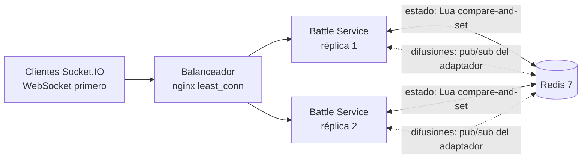
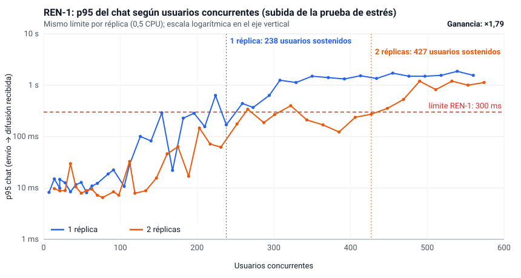
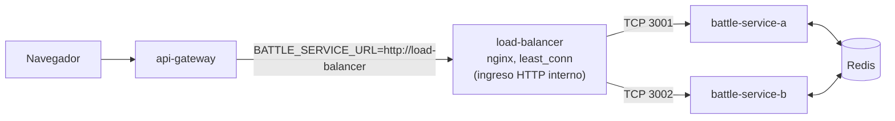

# REN-1: Rendimiento y latencia en tiempo real

Implementación y evidencia del escenario de calidad REN-1 de DanceSync (Squad Héroes, Arquitecturas de Software 2026-2).

| | |
|---|---|
| Estado | **Implementado y verificado en el prototipo local, y desplegado en Azure con el balanceador propio** (nginx delante de dos réplicas, [ADR-10](../adr/ADR-10-balanceador-propio-azure.md)). Falta la medición de carga en Azure (ver [Lo que queda pendiente](#lo-que-queda-pendiente)) |
| Repositorio | `DanceSync_BackEnd` (`battle-service`, `load-tests`, entorno de escala), rama `feat/rendimiento-latencia` |
| Alcance | Estado compartido en Redis, varias réplicas del Battle Service detrás de un balanceador, y las pruebas de carga y estrés que lo verifican. `api-gateway` y `users-service` no se modificaron |
| Decisiones | [ADR-01: estado de salas y rondas en Redis](../adr/ADR-01-estado-en-redis.md) · [ADR-02: balanceador y conexión por WebSocket sin afinidad](../adr/ADR-02-balanceador-solo-websocket.md) · [ADR-10: balanceador propio también en Azure](../adr/ADR-10-balanceador-propio-azure.md) |

## Contenido

1. [El escenario y cómo se cumple](#1-el-escenario-y-cómo-se-cumple)
2. [Cómo funciona](#2-cómo-funciona)
3. [Decisiones de diseño](#3-decisiones-de-diseño)
4. [Qué cambió en cada componente](#4-qué-cambió-en-cada-componente)
5. [Configuración](#5-configuración)
6. [Verificación y evidencia](#6-verificación-y-evidencia)
7. [Análisis de los resultados](#7-análisis-de-los-resultados)
   - [Despliegue en Azure con el balanceador propio](#despliegue-en-azure-con-el-balanceador-propio)
8. [Estado actual del escenario](#8-estado-actual-del-escenario)
9. [Lo que queda pendiente](#lo-que-queda-pendiente)

## 1. El escenario y cómo se cumple

| Lo que pide REN-1 | Resultado | Evidencia |
|---|---|---|
| 140 usuarios (20 salas de 7), 1 evento cada 2 s por usuario, 60 s de subida y 10 min sostenidos | 49.281 eventos enviados en 725 s (68 eventos/s entrantes) y 126.469 estados de sala recibidos por los clientes, además de los mensajes de chat | `nominal-dos-replicas-*.json` |
| p95 menor o igual a 300 ms desde que se envía el evento hasta que el cliente recibe el estado actualizado | Con 2 réplicas, Redis y balanceador: **chat 16,9 ms, voto 29,7 ms, fin de ronda 24,3 ms** | Ídem |
| Menos del 1 % de errores | **0 errores** | Ídem |
| Sin pérdida ni duplicación de puntajes, y un único ganador por ronda | 140 batallas y 420 rondas: 0 fines de ronda duplicados, 0 ganadores distintos entre clientes, 0 puntajes inconsistentes. Se mantuvo también en las pruebas de estrés con el sistema saturado (1.047 rondas más) | Las cuatro corridas |
| Difundir el estado a todos los participantes de la sala, aunque estén conectados a réplicas distintas | El adaptador de Socket.IO sobre Redis lleva cada difusión a todas las réplicas. Probado con una sala repartida entre dos instancias | `twoReplicas.socket.test.ts` |
| Prueba de estrés: 2 réplicas sostienen más usuarios que 1 con el mismo p95 (evidencia de escalabilidad horizontal) | Con 0,5 CPU por réplica: **1 réplica sostiene 238 usuarios y 2 réplicas 427, ×1,79** | `stress-*.json` y [gráfica](#prueba-de-estrés-1-réplica-contra-2) |

### Tácticas aplicadas

| Táctica (libro) | Cómo se aplica |
|---|---|
| Introducir concurrencia | Varias réplicas del Battle Service atienden salas a la vez |
| Mantener múltiples copias de cómputo | Réplicas idénticas y sin estado detrás de un balanceador |
| Mantener múltiples copias de datos | El estado de salas y rondas vive en Redis, compartido por todas las réplicas |
| Gestionar la demanda | Límite de eventos por conexión (escenario SEG-3, pendiente) |
| Reducir la sobrecarga | El video viaja por WebRTC entre navegadores y nunca pasa por el servidor (ADR-08) |

## 2. Cómo funciona



- **Cualquier réplica atiende cualquier conexión.** Ninguna guarda estado propio de las salas: lo leen y escriben en Redis. Una sala puede tener a sus jugadores repartidos entre réplicas.
- **Las difusiones cruzan réplicas.** `io.to(sala).emit(...)` publica el mensaje en Redis, y cada réplica lo entrega a los sockets de esa sala que tiene conectados. `io.in(sala).fetchSockets()` también cuenta los sockets de todas las réplicas.
- **Una sola decisión por cambio.** Cada cambio de sala lee el estado y su versión, ejecuta la regla de dominio y escribe solo si la versión no cambió (un script Lua en Redis). Si otra réplica escribió antes, se vuelve a decidir sobre el estado nuevo. Abrir, ganar y expirar una ronda de Word Race son, cada uno, un único paso atómico en Redis: dos bailarines que responden a la vez desde réplicas distintas producen exactamente un ganador.
- **Sin Redis, todo sigue igual.** Si `REDIS_URL` no está definida, el servicio usa los repositorios en memoria de siempre, como una sola instancia.

## 3. Decisiones de diseño

- **Implementar los puertos, no cambiar el dominio.** `RoomRepository` y `WordRaceRepository` ya definían las operaciones atómicas. Se agregaron `RedisRoomRepository` y `RedisWordRaceRepository` en `infrastructure/redis`; `domain` y `application` no cambiaron. Ver [ADR-01](../adr/ADR-01-estado-en-redis.md).
- **Lua en lugar de `WATCH`/`MULTI`.** `WATCH` queda atado a una conexión, y el repositorio comparte una para todas las operaciones. Un script Lua se ejecuta de forma atómica dentro de Redis y da la misma garantía de compare-and-set sin conexiones dedicadas.
- **Un contrato, dos implementaciones.** Las mismas pruebas se exigen a la versión en memoria y a la de Redis, incluida la concurrencia real con conflictos de versión provocados a propósito.
- **WebSocket desde el inicio, sin afinidad de sesión.** Con long-polling, cada petición de una sesión tendría que llegar a la misma réplica. Con WebSocket, la conexión vive en una sola réplica de principio a fin, así que el balanceador reparte libremente. El frontend conecta por WebSocket directamente y deja long-polling solo como respaldo. Ver [ADR-02](../adr/ADR-02-balanceador-solo-websocket.md).
- **Comparación justa.** Las dos réplicas tienen el mismo límite de CPU y memoria en todas las pruebas, y la prueba de 1 réplica usa la misma pila (Redis, adaptador y balanceador): lo único que cambia es cuántas réplicas reciben tráfico.
- **La carga se autentica como un usuario real.** Desde SEG-1 el Battle Service exige token. Las pruebas no desactivan la autenticación: el anfitrión de cada sala usa un token con el formato de Entra ID firmado por un Entra ID simulado, y los demás entran como invitados. El costo de validar tokens queda incluido en las mediciones.

## 4. Qué cambió en cada componente

### battle-service

| Archivo | Qué hace |
|---|---|
| `infrastructure/redis/redisConfig.ts` | Lee y valida `REDIS_URL` y los demás ajustes; nunca imprime credenciales |
| `infrastructure/redis/RedisRoomRepository.ts` | Salas en un hash por sala (`data` y `version`); `insert` y `update` con scripts Lua de compare-and-set y reintentos acotados |
| `infrastructure/redis/RedisWordRaceRepository.ts` | Carrera de palabras en un hash por sala; abrir, ganar y expirar rondas con scripts Lua atómicos |
| `infrastructure/redis/roomCodec.ts`, `luaScripts.ts` | Serialización de la sala (conserva las fechas) y registro de los scripts |
| `infrastructure/redis/stateStores.ts` | Elige memoria o Redis según `REDIS_URL` y conecta el adaptador de Socket.IO |
| `server.ts` | Cuatro cambios: crea los repositorios con `createStateStores()`, conecta el adaptador y cierra Redis al apagar |
| `test/stateStores.contract.test.ts`, `test/twoReplicas.socket.test.ts`, `test/redisConfig.test.ts` | Contrato de ambos repositorios, batalla con dos réplicas y configuración |
| `package.json` | Agrega `ioredis` y `@socket.io/redis-adapter` |

### Frontend (`DanceSync_FrontEnd`)

| Archivo | Qué hace |
|---|---|
| `src/shared/lib/socket.ts` | `transports: ['websocket', 'polling']` con `tryAllTransports: true`: WebSocket desde el inicio y long-polling solo si WebSocket falla (ADR-02) |
| `src/shared/lib/socket.test.ts` | Fija esa configuración; falla con la anterior |

### Pipeline

| Archivo | Qué hace |
|---|---|
| `.github/workflows/backend-ci.yml` | El trabajo de `battle-service` levanta Redis 7 y define `TEST_REDIS_URL`, así que las pruebas de Redis corren en cada pull request |

### Entorno de escala y pruebas de carga

| Archivo | Qué hace |
|---|---|
| `docker-compose.scale.yml` | Redis, Entra ID simulado, dos réplicas con el mismo límite de recursos y nginx en `http://localhost:8088` |
| `load-balancer/nginx.conf`, `upstream-1.conf`, `upstream-2.conf` | Balanceador con actualización a WebSocket y conexiones largas, `least_conn`, verificación de salud pasiva y sin afinidad de sesión; 1 o 2 réplicas reciben tráfico |
| `load-tests/lib/room-bot.cjs` | Cada usuario virtual de Artillery es una sala de 7 jugadores que juega el flujo real y mide latencias y correctitud |
| `load-tests/lib/fake-entra.cjs`, `scripts/fake-entra.mjs` | Entra ID simulado (JWKS local) para que la carga se autentique |
| `load-tests/scenarios/*.yml` | Humo, carga nominal y estrés |
| `load-tests/scripts/run.mjs`, `monitor.mjs` | Ejecuta una sola prueba a la vez, detecta el número de réplicas y mide la CPU de la máquina y de cada contenedor |
| `load-tests/scripts/summary.mjs`, `stress-analysis.mjs`, `compare.mjs`, `chart.mjs` | Resumen contra el criterio, análisis del estrés, comparación 1 vs 2 réplicas y gráfica |

## 5. Configuración

### Battle Service

| Variable | Por defecto | Descripción |
|---|---|---|
| `REDIS_URL` | vacía | `redis://` o `rediss://`. Vacía: estado en memoria (una instancia). Definida: estado en Redis y adaptador de Socket.IO |
| `REDIS_STATE_TTL_SECONDS` | `86400` | Una sala o carrera que nadie vuelve a tocar expira a este tiempo |
| `REDIS_UPDATE_MAX_ATTEMPTS` | `12` | Reintentos de una actualización de sala que sigue perdiendo la carrera |
| `SOCKETIO_REDIS_KEY` | `dancesync` | Prefijo de los canales del adaptador; igual en todas las réplicas |

### Entorno de escala (`docker-compose.scale.yml`)

| Variable | Por defecto | Descripción |
|---|---|---|
| `LB_REPLICAS` | `2` | Cuántas réplicas reciben tráfico del balanceador (`1` o `2`) |
| `BATTLE_CPUS` / `BATTLE_MEMORY` | `0.5` / `512m` | Límite de cada réplica; el mismo en todas las pruebas |
| `LB_PORT` | `8088` | Puerto del balanceador |

Las credenciales de ese archivo son de prueba y solo sirven con el Entra ID simulado. No deben usarse en un despliegue.

## 6. Verificación y evidencia

### Entorno de las pruebas

| | |
|---|---|
| Máquina | Intel Core i7-6700T (4 núcleos, 8 hilos), 32 GB de RAM, Windows con Docker Desktop |
| Sistema bajo prueba | `docker-compose.scale.yml`: 2 réplicas del Battle Service (0,5 CPU y 512 MB cada una), Redis 7 y nginx |
| Generador | Artillery 2.0.34 con `load-tests/lib/room-bot.cjs`, en la misma máquina. Su retraso de bucle de eventos se midió en cada corrida (p95 de unos 13 ms: sano) |
| Autenticación | Activa (SEG-1): anfitrión con token tipo Entra ID, el resto como invitados |
| Medición | Desde el cliente de prueba: desde que se envía el evento hasta que se recibe la difusión correspondiente. Incluye la red de Docker, no la de internet |

### Pruebas automatizadas

| Suite | Comando | Resultado |
|---|---|---|
| `battle-service`, sin Redis | `pnpm test` | 277 pruebas, 277 pasan (las de Redis se omiten) |
| `battle-service`, con Redis | `TEST_REDIS_URL=redis://localhost:6379 pnpm test` | 297 pruebas, 297 pasan. También en el pipeline: `backend-ci.yml` levanta un Redis y define `TEST_REDIS_URL` |
| Tipos del servicio y de las pruebas | `pnpm typecheck` | Sin errores |

Las pruebas de Redis exigen el mismo contrato a las dos implementaciones. Entre ellas: 6 jugadores uniéndose a la vez a una sala no pierden ninguna unión y sí provocan conflictos reales de versión; 100 envíos simultáneos de la palabra correcta producen exactamente un ganador y un solo punto. La prueba de dos réplicas juega una batalla completa con los jugadores repartidos entre dos instancias que solo comparten Redis. Su control negativo es quitar el adaptador: la prueba falla, porque una réplica ve 2 sockets de la sala en lugar de 4.

### Carga nominal (140 usuarios, 10 minutos)

| Métrica | Línea base: 1 instancia, estado en memoria | Arquitectura objetivo: 2 réplicas, Redis y balanceador | Criterio |
|---|---|---|---|
| p95 chat (envío → difusión recibida) | 1,9 ms | **16,9 ms** | ≤ 300 ms |
| p95 voto (envío → estado recibido) | 2,5 ms | **29,7 ms** | ≤ 300 ms |
| p95 palabra ganadora → fin de ronda | 1,9 ms | 24,3 ms | |
| p99 chat / voto | 2,9 / 3,5 ms | 74,4 / 122,7 ms | |
| p95 HTTP crear sala / token de invitado | 3,7 / 3,4 ms | 45,2 / 16,6 ms | |
| Eventos enviados / errores | 49.368 / 0 | 49.281 / **0** | < 1 % |
| Batallas / rondas de Word Race | 140 / 420 | 140 / 420 | |
| Fines duplicados, ganadores distintos, puntajes inconsistentes | 0 / 0 / 0 | **0 / 0 / 0** | 0 |

La línea base se tomó con el servicio fuera de Docker y sin límite de CPU, antes de agregar Redis. Sirve de referencia del costo de la distribución, no como comparación de capacidad; esa comparación es la prueba de estrés.

Durante la carga nominal con 2 réplicas, cada una usó entre el 22 % y el 24 % de un núcleo (casi la mitad de su límite de 0,5) y recibió una parte equivalente del tráfico (202 MB y 186 MB de entrada).

### Prueba de estrés: 1 réplica contra 2

Rampa de salas de 7 jugadores (4, 6, 9, 12, 15, 18 y 18 salas por minuto) hasta 574 usuarios, primero con 1 réplica recibiendo tráfico y luego con 2, una prueba después de la otra y con el entorno reiniciado entre ambas. El máximo sostenido es el mayor número de usuarios con p95 ≤ 300 ms antes de superar el límite en dos intervalos seguidos de 10 s, para que un pico aislado no cuente como saturación.



| | 1 réplica | 2 réplicas |
|---|---|---|
| **Máximo de usuarios sostenido con p95 ≤ 300 ms** | **238** | **427** (×1,79) |
| Usuarios al superar el límite de forma sostenida | 259 | 448 |
| Eventos procesados en la corrida | 49.135 | 63.861 (+30 %) |
| p95 HTTP crear sala en toda la corrida | 8,7 s | 0,67 s |
| Errores | 30 (0,06 %) | 5 (0,01 %) |
| Rondas / fines duplicados, ganadores distintos, puntajes inconsistentes | 486 / 0, 0, 0 | 561 / 0, 0, 0 |

Recursos medidos cada 5 s durante cada corrida (100 % = un núcleo; el tope de cada réplica es 50 %):

| Contenedor | 1 réplica: CPU máx / prom. | 2 réplicas: CPU máx / prom. |
|---|---|---|
| `battle-1` | 54,0 % / 33,8 % (al tope) | 52,5 % / 29,7 % (al tope) |
| `battle-2` | 32,6 % / 8,1 % (sin clientes) | 52,3 % / 29,5 % (al tope) |
| Redis | 16,8 % / 7,3 % | 20,7 % / 8,9 % |
| nginx | 23,4 % / 9,2 % | 28,4 % / 12,5 % |
| Máquina completa (8 hilos) | 44,2 % / 31,0 % | 57,7 % / 39,3 % |

Los promedios incluyen la subida inicial y el final de la corrida, cuando hay pocos usuarios; el máximo es el dato que indica saturación.

### Archivos de evidencia

En [`ren-1/evidence/`](ren-1/evidence/), los reportes JSON que genera Artillery y, para cada corrida de estrés, sus metadatos (`.meta.json`: réplicas con tráfico, límite de CPU, inicio, fin y recursos) y la serie de recursos (`.recursos.csv`).

| Archivo | Prueba |
|---|---|
| `nominal-base-1-replica-2026-11-14T03-43-12.json` | Carga nominal, línea base |
| `nominal-dos-replicas-2026-11-14T23-37-51.json` | Carga nominal, arquitectura objetivo |
| `stress-estres-1-replica-2026-11-15T01-02-27.*` | Estrés con 1 réplica |
| `stress-estres-2-replicas-2026-11-15T01-14-11.*` | Estrés con 2 réplicas |

En los `.meta.json` y `.recursos.csv` de estas corridas, la memoria de los contenedores sin límite propio (Redis, nginx, Entra ID simulado, PostgreSQL) está multiplicada por 1.024: el monitor tomaba la unidad del límite en lugar de la del valor usado. Ya está corregido en `monitor.mjs`. Los datos de CPU y la memoria de las réplicas son correctos.

Para volver a imprimir el resumen o la comparación:

```bash
cd load-tests
node scripts/summary.mjs ../docs/quality/ren-1/evidence/nominal-dos-replicas-2026-11-14T23-37-51.json nominal
node scripts/compare.mjs ../docs/quality/ren-1/evidence/stress-estres-1-replica-2026-11-15T01-02-27.json ../docs/quality/ren-1/evidence/stress-estres-2-replicas-2026-11-15T01-14-11.json
node scripts/chart.mjs ../docs/quality/ren-1/evidence/stress-estres-1-replica-2026-11-15T01-02-27.json ../docs/quality/ren-1/evidence/stress-estres-2-replicas-2026-11-15T01-14-11.json ../docs/quality/img/ren1/estres-1-vs-2-replicas.svg
```

## 7. Análisis de los resultados

**La comparación es válida.** Las dos corridas de estrés se hicieron una después de la otra, con el mismo límite por réplica, y en cada una el script registró cuántas réplicas recibían tráfico. El generador estuvo sano en ambas. Redis (máximo 20,7 %), nginx (28,4 %) y la máquina (57,7 % de sus hilos) no se saturaron; las réplicas sí llegaron a su tope. El cuello de botella fue la CPU de las réplicas, que es lo que se quería comparar.

**Por qué ×1,79 y no ×2.** En la corrida de 1 réplica, `battle-2` no tenía ningún cliente y aun así usó en promedio 8,1 % de CPU, unas 0,24 veces lo que usó la réplica activa. Ese trabajo es procesar las difusiones de la otra réplica que llegan por Redis: el adaptador entrega cada difusión a todas las réplicas, y cada una descarta lo que no le corresponde. Con 2 réplicas activas, cada una paga ese costo por las difusiones de la otra, lo que explica la mayor parte de la diferencia con el ideal.

**El precio de distribuir.** Con la misma carga nominal, el p95 pasa de unos 2 ms (una instancia en memoria) a 17–30 ms (Redis, adaptador, balanceador y límite de CPU). Sigue más de 10 veces por debajo del criterio, y es lo que permite escalar y recuperarse de la caída de una réplica (escenario DIS-1).

**Margen.** La carga del escenario (140 usuarios) queda con un margen de ×1,7 con 1 réplica y de ×3 con 2 réplicas, con 0,5 CPU por réplica.

**La correctitud no depende de la carga.** Incluso saturado, con el p95 por encima de 1,5 s, el sistema no duplicó ni perdió puntos y cada ronda tuvo un único ganador visto igual por todos los clientes. Lo que se degrada es la latencia, no las reglas del juego.

**Throughput.** Los bots esperan el acuse de cada evento antes de enviar el siguiente, así que un servidor saturado los frena: con 2 réplicas se procesaron un 30 % más de eventos en el mismo tiempo. Por la misma razón, la creación de salas por HTTP se degrada tanto con 1 réplica (p95 de 8,7 s): comparte el bucle de eventos con Socket.IO.

**Límites de la medición.**

- Las pruebas entran por el balanceador directamente; el **API Gateway no estuvo en el camino**, aunque el escenario lo nombra como artefacto. En producción la conexión pasa por él.
- El generador y el sistema comparten la máquina. Se verificó que el generador no se saturó, pero sí compiten por la CPU.
- La latencia no incluye la red entre el navegador y Azure; en la nube el p95 será mayor.
- Cada configuración de estrés se corrió una vez. Los picos aislados de la gráfica (por ejemplo, 633 ms con 224 usuarios y una réplica) muestran la variabilidad entre intervalos.
- Los números absolutos dependen del límite de 0,5 CPU por réplica; lo que se generaliza es la comparación relativa.

## Despliegue en Azure con el balanceador propio

Requisito del curso: el reparto entre réplicas lo hace un balanceador nuestro, no el de la plataforma. En Azure, `battle-service` era una Container App con 2 réplicas y el ingreso de Container Apps elegía la réplica; ahora cada réplica es su propia app y nuestro nginx decide ([ADR-10](../adr/ADR-10-balanceador-propio-azure.md)).



| Container App | Imagen | Ingreso | Réplicas | CPU / memoria |
|---|---|---|---|---|
| `load-balancer` | `load-balancer` (`load-balancer/azure/`: nginx 1.27 con nuestra configuración) | HTTP interno, puerto 80 | 1 | 0,25 / 0,5 GiB |
| `battle-service-a` | `battle-service` (la misma que el pipeline despliega) | TCP interno, puerto 3001 | 1 | 0,5 / 1 GiB |
| `battle-service-b` | `battle-service` | TCP interno, puerto 3002 | 1 | 0,5 / 1 GiB |
| `battle-service` (anterior) | | | 0 (respaldo) | |

- **Por qué TCP.** Con ingreso TCP, Azure solo pasa bytes hacia la réplica: no enruta por nombre de host ni elige destino. El puerto de cada app identifica la réplica en el registro de nginx (`"replica":"battle-service-a"`).
- **`TRUSTED_PROXY_HOPS=4`** en las réplicas (ingreso del gateway, gateway, ingreso de nginx y nginx). En el gateway sigue en 1.
- **Registro del balanceador.** Una línea JSON `lb.request` por petición, con la réplica, el destino y el estado. Una conexión WebSocket aparece al cerrarse (estado 101 y su duración). `GET /lb-status` (solo dentro del entorno) da las conexiones activas.

### Verificación en Azure (17 de noviembre de 2026)

Con `load-tests/demo/dancesync-bot.mjs` desde Azure Cloud Shell y con la app real. Salidas completas en [`ren-1/evidence/azure/`](ren-1/evidence/azure/).

| Prueba | Resultado |
|---|---|
| Partida completa desde el frontend (PC y teléfono) | Funciona. Sus dos WebSocket fueron uno a cada réplica |
| 20 conexiones de invitado durante 60 s | 20 de 20 abiertas todo el minuto; `lb-status`: 22 conexiones activas; reparto en el registro de nginx: **12 a la réplica a y 11 a la b** |
| Caída de `battle-service-a` (`az containerapp revision restart`) con 10 conexiones abiertas | Cayeron solo las 4 de la réplica a; **se recuperaron en la b en 0,6-2,4 s** (criterio DIS-1: < 30 s) y las que tenían asiento volvieron a la sala |
| Ataque de un cliente a 200 eventos por segundo (SEG-3) | Limitado a los 258 ms y bloqueado a los 483 ms; la IP registrada es la del cliente (ver [SEG-3](SEG-3-proteccion-abuso.md)) |

Las reconexiones de 2,4 s son las que llegaron a nginx antes de que marcara la réplica caída: esperaron `proxy_connect_timeout` (2 s) y el intento se repitió en la otra réplica. Después de ese primer fallo, ninguna conexión más fue a la réplica caída.

Estas pruebas verifican el reparto y la recuperación en Azure. No son una medición de rendimiento: la carga nominal de 140 usuarios no se ha repetido en Azure.

## 8. Estado actual del escenario

Texto para la sección "Estado actual" de REN-1 en el documento de escenarios:

> **Implementado y verificado en el prototipo local.** Estado de salas y rondas en Redis, adaptador de Socket.IO entre réplicas, balanceador nginx con 2 réplicas del Battle Service y clientes que conectan por WebSocket desde el inicio. Con 140 usuarios durante 10 minutos, p95 de 16,9 ms (chat) y 29,7 ms (voto), 0 errores y sin pérdida ni duplicación de puntajes. En la prueba de estrés, con 0,5 CPU por réplica, 1 réplica sostiene 238 usuarios y 2 réplicas 427 con p95 ≤ 300 ms (×1,79). Las pruebas de Redis corren en el pipeline. En Azure, el mismo nginx reparte entre `battle-service-a` y `battle-service-b` (12 y 11 conexiones de 23) y, al caer una réplica, las conexiones se recuperan en la otra en menos de 2,5 s. Pendiente: la medición de carga en Azure.

## Lo que queda pendiente

**No verificado**

- **Medición de carga en Azure.** Repetir la carga nominal contra el despliegue en Azure. La carga nominal a través del API Gateway ya se midió en local (p95 66,0 ms chat y 98,5 ms voto, 0 errores). En Azure el generador no puede autenticarse con el Entra ID simulado: la prueba necesita salas creadas con cuentas reales o un emisor de prueba aceptado por el despliegue.

**Por hacer**

- **Salud con Redis.** `GET /api/battles/health` no comprueba Redis; una réplica sin Redis debería salir de rotación.
- ~~**Despliegue.**~~ Hecho: Redis como Container App (ADR-06) y dos réplicas detrás del balanceador propio ([ADR-10](../adr/ADR-10-balanceador-propio-azure.md)).

**Relacionado con otros escenarios**

- **DIS-1.** Los temporizadores de rondas y batallas siguen en la memoria de cada réplica. Si una réplica cae a mitad de batalla, la sala y los puntajes se conservan en Redis, pero sus temporizadores pendientes no se reprograman en otra réplica.
- **SEG-3.** El límite de eventos por conexión (gestionar la demanda) es parte de SEG-3. El script de carga sirve para su prueba de "140 usuarios más 5 clientes abusivos".

**Mejoras posibles**

- **Adaptador por salas.** El adaptador "sharded" de Socket.IO (Redis 7, `createShardedAdapter` con suscripción dinámica) hace que cada réplica reciba solo las difusiones de las salas que atiende, y reduciría el costo que separa ×1,79 del ideal.

**Observación**

- `test/wordRace.socket.test.ts` (anterior a este escenario, no usa Redis) es sensible al tiempo: con la máquina muy cargada puede fallar una aserción sobre `expiresInMs`. Repetida sola pasa siempre.

## Cómo reproducir

```bash
# Pruebas del battle-service, sin y con Redis
cd DanceSync_BackEnd/battle-service
pnpm install --frozen-lockfile
pnpm typecheck
pnpm test
docker run -d --name redis-test -p 6379:6379 redis:7
TEST_REDIS_URL=redis://localhost:6379 pnpm test        # en CMD: set TEST_REDIS_URL=redis://localhost:6379

# Entorno de escala (en CMD, cada "set" en su propia línea)
cd ..
docker compose -f docker-compose.scale.yml up -d --build

# Carga nominal y estrés (una prueba a la vez)
cd load-tests
npm install                                             # en CMD, antes: set PLAYWRIGHT_SKIP_BROWSER_DOWNLOAD=1
node scripts/run.mjs nominal --target http://localhost:8088 --label dos-replicas
node scripts/run.mjs stress  --target http://localhost:8088 --label estres-2-replicas
```

Para la corrida de 1 réplica: `docker compose -f docker-compose.scale.yml down`, `LB_REPLICAS=1` y otra vez `up -d`. El detalle está en [`load-tests/README.md`](../../load-tests/README.md).
