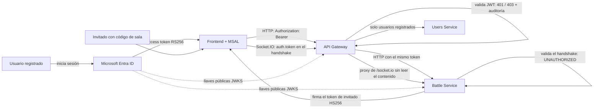
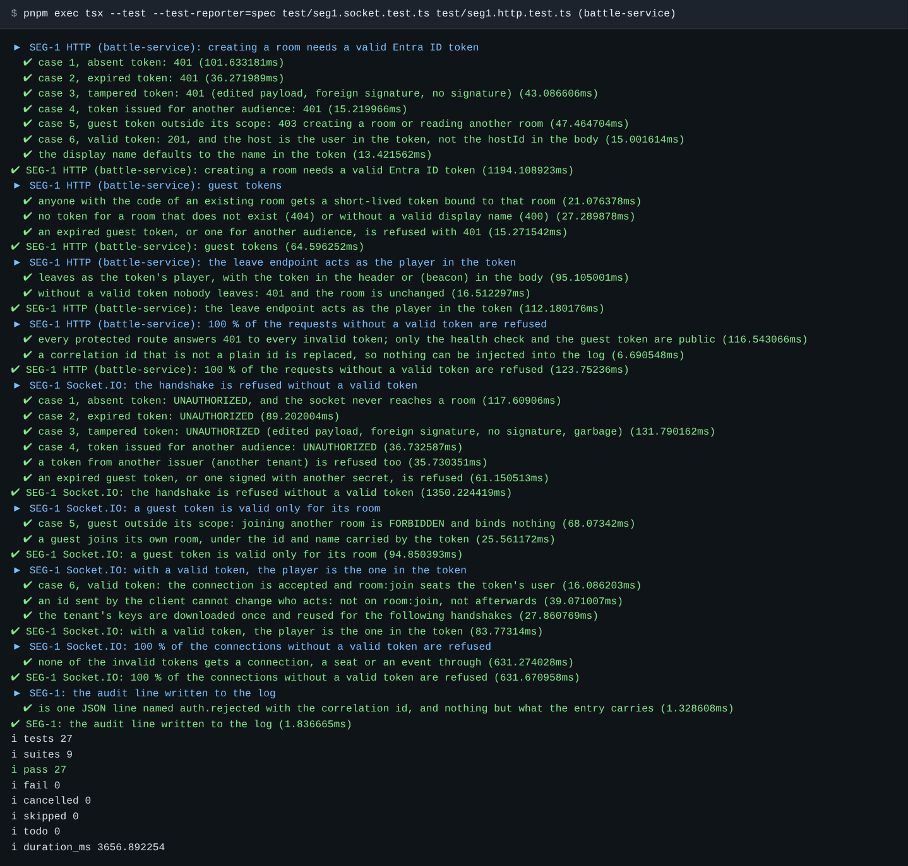
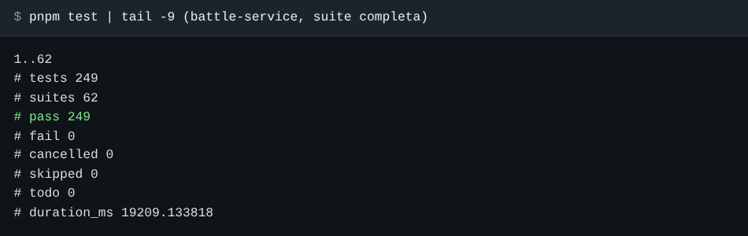
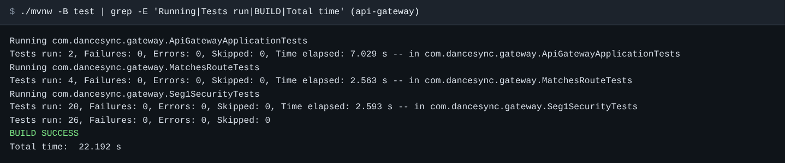
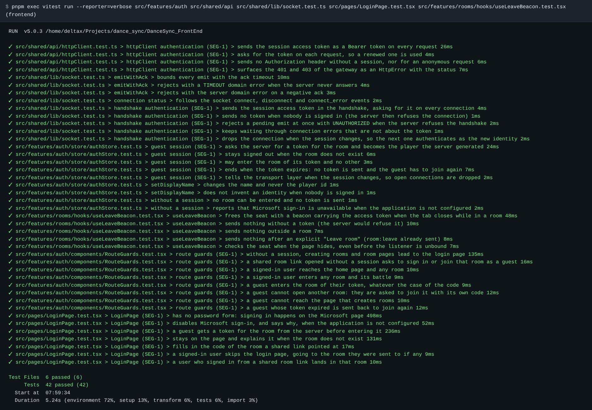
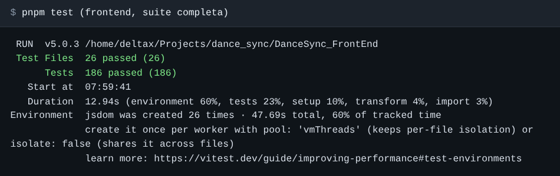
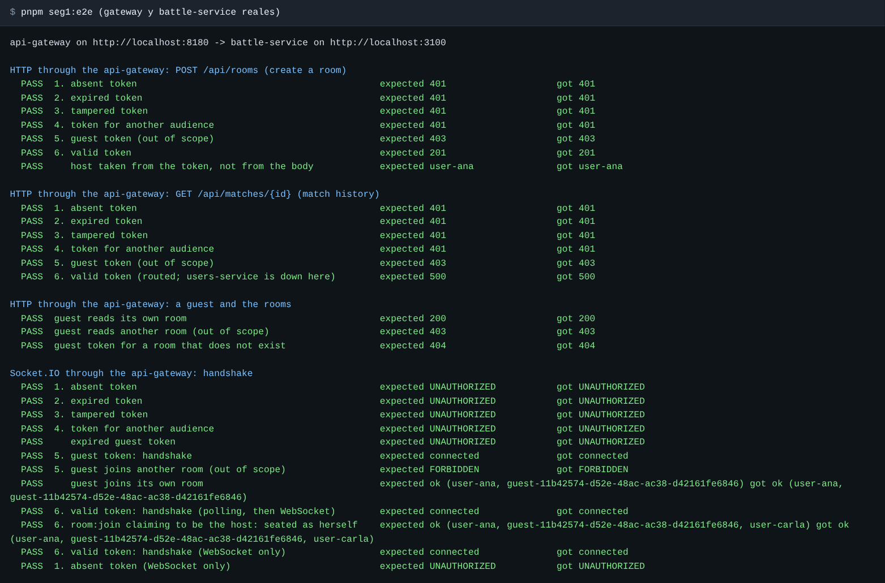
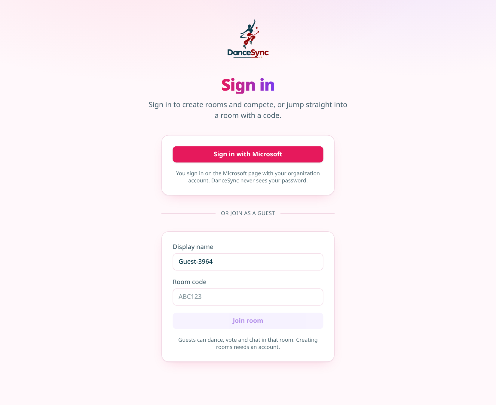
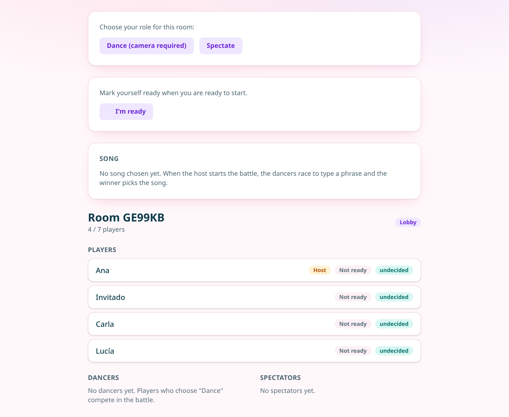
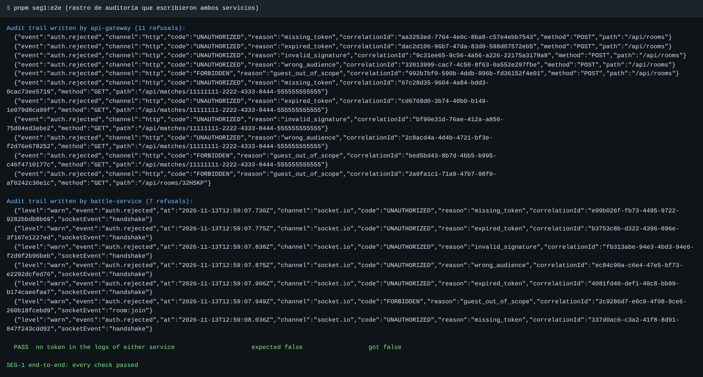

# SEG-1: Seguridad, autenticación

Implementación y evidencia del escenario de calidad SEG-1 de DanceSync (Squad Héroes, Arquitecturas de Software 2026-2).

| | |
|---|---|
| Estado | **Implementado y verificado con pruebas automatizadas.** Falta la prueba con un tenant real de Microsoft Entra ID (ver [Lo que queda pendiente](#lo-que-queda-pendiente)) |
| Repositorios | `DanceSync_BackEnd` (`api-gateway`, `battle-service`) y `DanceSync_FrontEnd`, rama `feat/auth` |
| Alcance | Solo lo que pide SEG-1. `users-service` no se modificó |

## Contenido

1. [El escenario y cómo se cumple](#1-el-escenario-y-cómo-se-cumple)
2. [Cómo funciona](#2-cómo-funciona)
3. [Decisiones de diseño](#3-decisiones-de-diseño)
4. [Qué cambió en cada componente](#4-qué-cambió-en-cada-componente)
5. [Configuración](#5-configuración)
6. [Verificación y evidencia](#6-verificación-y-evidencia)
7. [Rastro de auditoría](#7-rastro-de-auditoría)
8. [Lo que queda pendiente](#lo-que-queda-pendiente)

## 1. El escenario y cómo se cumple

| Lo que pide SEG-1 | Cómo se cumple | Dónde se prueba |
|---|---|---|
| El gateway valida firma, vencimiento, emisor y audiencia del token de Microsoft Entra ID; si no es válido responde 401 y registra el intento | `api-gateway` es un servidor de recursos OAuth2 (Spring Security). Valida cada JWT antes de enrutar; solo acepta RS256 con las llaves del tenant | `Seg1SecurityTests` (gateway) |
| En Socket.IO el token viaja en el handshake y el Battle Service lo valida antes de aceptar la conexión; si no, la rechaza con `UNAUTHORIZED` y no la asocia a ninguna sala | Middleware `io.use(...)` en `battle-service`: se ejecuta antes del evento `connection`. Un socket rechazado nunca llega a los manejadores | `seg1.socket.test.ts` |
| Quien no tiene cuenta entra como invitado con el código de la sala: token firmado por el servidor, de corta duración y válido solo para esa sala. No crea salas ni consulta historial | `POST /api/rooms/{code}/guest-token` emite un JWT HS256 con el reclamo `room`. Vence a las 2 horas (configurable). Fuera de su sala responde 403 / `FORBIDDEN` | `seg1.http.test.ts`, `seg1.socket.test.ts`, `Seg1SecurityTests` |
| La identidad del jugador sale del token, no de un identificador enviado por el cliente | El `playerId` es el reclamo `oid` (usuario) o `sub` (invitado). Los identificadores que mande el cliente se ignoran o solo se contrastan | `seg1.socket.test.ts`, `seg1.http.test.ts` |
| El 100 % de las peticiones y conexiones sin token válido es rechazado | Lo que no está configurado se rechaza, nunca se omite. Hay una prueba de matriz por canal: todo token inválido contra toda ruta protegida | Pruebas "100 %" en las tres suites |
| Cada rechazo queda registrado con el identificador de correlación, sin guardar el token | Una línea JSON `auth.rejected` por rechazo con `correlationId`. Las pruebas comprueban que el token no aparece en el log | Las tres suites |
| Pruebas automatizadas por HTTP y por Socket.IO con los 6 casos, ejecutadas en el pipeline | Las suites corren con los comandos que ya ejecuta el CI (`./mvnw -B verify`, `pnpm test`) | [Sección 6](#6-verificación-y-evidencia) |

## 2. Cómo funciona



Hay dos tipos de token. Cada servicio elige con qué llaves validarlo según el emisor (`iss`), y cada emisor tiene su propio algoritmo:

| | Usuario registrado | Invitado |
|---|---|---|
| Emisor | Microsoft Entra ID (`https://login.microsoftonline.com/{tenant}/v2.0`), de cualquier organización o cuenta personal (ver [Quién puede iniciar sesión](#quién-puede-iniciar-sesión)) | `battle-service` (`dancesync-battle-service`) |
| Firma | RS256, llaves públicas del tenant (JWKS) | HS256, secreto compartido `GUEST_TOKEN_SECRET` |
| Audiencia | El client id de la aplicación | `dancesync-guest` |
| Identidad | Reclamo `oid` | Reclamo `sub`, generado por el servidor (`guest-<uuid>`) |
| Alcance | Todo | Solo la sala del reclamo `room` |
| Vigencia | La que da Entra ID (cerca de 1 hora, MSAL lo renueva) | 2 horas por defecto |

Respuestas ante un intento no autorizado:

| Situación | HTTP | Socket.IO |
|---|---|---|
| Sin token, vencido, manipulado, de otra audiencia o de otro emisor | `401` con `WWW-Authenticate: Bearer` | `connect_error` con mensaje `UNAUTHORIZED`; no hay conexión |
| Token de invitado válido usado fuera de su alcance | `403` | El handshake se acepta; `room:join` a otra sala responde `FORBIDDEN` y el socket no queda asociado a ninguna sala |

Se distingue 401 de 403 a propósito: 401 significa "no sé quién eres", 403 significa "sé quién eres y no puedes hacer esto".

### Quién puede iniciar sesión

`AZURE_TENANT_ID` (backend) y `VITE_AZURE_TENANT_ID` (frontend) llevan el mismo valor y deciden quién entra con Microsoft:

| Valor | Quién puede iniciar sesión |
|---|---|
| `common` (el recomendado) | Cualquier cuenta de cualquier organización y cuentas personales de Microsoft (Outlook, Hotmail). Nadie tiene que invitar a nadie |
| `organizations` | Cualquier cuenta de cualquier organización, sin cuentas personales |
| Un tenant id | Solo los usuarios de ese tenant, o los invitados a él |

Aceptar cualquier tenant no relaja la validación. La firma, el vencimiento y la audiencia se revisan igual, y además el emisor tiene que ser uno de Entra ID v2.0 (`https://login.microsoftonline.com/{tenant}/v2.0`) y nombrar el mismo tenant que el reclamo `tid` del token. Un emisor inventado o incoherente se rechaza con `wrong_issuer`. Las llaves se toman del endpoint común de Entra ID, el mismo para todos los tenants.

Una salvedad que no depende del código: la aplicación no tiene editor verificado. Por eso, las organizaciones que solo permiten que sus usuarios den consentimiento a aplicaciones verificadas exigirán que un administrador de esa organización lo apruebe. Las cuentas personales y las organizaciones con la política por defecto anterior no tienen ese problema. Para eliminarlo del todo, hay que verificar el editor (requiere una cuenta de Microsoft Partner Network).

### Rutas del gateway

| Ruta | Quién puede |
|---|---|
| `POST /api/rooms` (crear sala) | Usuario registrado |
| `GET /api/matches/**` (historial), `/api/users/**`, resto de `/actuator/**` y cualquier otra ruta | Usuario registrado |
| `GET /api/rooms/{code}` | Usuario registrado, o el invitado de esa sala |
| `POST /api/rooms/{code}/guest-token` | Abierta: es la forma de obtener el token de invitado |
| `/socket.io/**` | Abierta en el gateway: el token va dentro del handshake y lo valida el Battle Service |
| `POST /api/rooms/{code}/leave` | Abierta en el gateway: el token va en el cuerpo y lo valida el Battle Service |
| `GET /actuator/health`, `GET /api/battles/health`, `OPTIONS` (preflight CORS) | Abiertas |

Las dos rutas "abiertas en el gateway" no quedan sin autenticar. La validación ocurre en el Battle Service, que rechaza y registra igual. En el caso de `/leave` el motivo es técnico: lo envía `navigator.sendBeacon` al cerrar la pestaña, y un beacon no puede poner cabeceras.

## 3. Decisiones de diseño

- **El Battle Service vuelve a validar el token en HTTP.** El gateway ya rechazó la petición, pero validar de nuevo es lo que permite sacar el `playerId` del token y no del cuerpo, y deja el servicio protegido si alguien lo alcanza sin pasar por el gateway.
- **Fallar cerrado.** Si faltan `AZURE_TENANT_ID` / `AZURE_CLIENT_ID`, todo token de usuario se rechaza. Si falta `GUEST_TOKEN_SECRET`, no se emiten ni se aceptan tokens de invitado. Los servicios arrancan y avisan en el log; no existe un modo "sin autenticación". Un secreto de menos de 32 bytes detiene el arranque.
- **Un algoritmo por emisor.** Entra ID solo RS256, invitado solo HS256. Así se rechazan `alg: none` y el ataque de firmar con HS256 usando la llave pública.
- **Los identificadores del cliente pasan a ser opcionales.** Los campos `playerId`, `requesterId`, `senderId`, `voterId` y `from` de los eventos ya no definen quién actúa. Si vienen y no coinciden con el jugador del token, el evento se rechaza con `PLAYER_NOT_IN_ROOM`, como antes. El frontend los sigue enviando; no fue necesario tocar cada pantalla.
- **Motivo detallado solo en el log.** El cliente recibe un mensaje genérico. El motivo exacto (`expired_token`, `invalid_signature`, ...) queda en la auditoría, para no darle pistas a un atacante.
- **CORS también en los rechazos.** El filtro de seguridad agrega las cabeceras CORS a sus propias respuestas. Sin eso el navegador ocultaría el 401 tras un error de red genérico y el frontend no podría reaccionar.
- **Sesión por pestaña en el frontend.** Los tokens viven en `sessionStorage`. Las guardas de rutas son solo navegación: quien rechaza de verdad es el backend.

## 4. Qué cambió en cada componente

### api-gateway

| Archivo | Qué hace |
|---|---|
| `pom.xml` | Agrega `spring-boot-starter-security-oauth2-resource-server` |
| `security/SecurityConfig.java` | Cadena de seguridad, reglas por ruta, validadores de cada emisor, CORS |
| `security/AuthProperties.java` | Configuración `dancesync.auth.*` |
| `security/CorrelationIdFilter.java` | Asigna `X-Correlation-Id` antes de la seguridad, lo devuelve y lo reenvía |
| `security/AuthRejectionHandler.java` | Responde 401 / 403 y escribe la línea de auditoría |
| `application.yml` | Variables de autenticación |
| `Seg1SecurityTests.java`, `support/FakeEntra.java`, `support/UpstreamStub.java` | Suite SEG-1 y sus apoyos |
| `MatchesRouteTests.java`, `ApiGatewayApplicationTests.java` | Ahora envían token; se agregó el caso "sin configuración se rechaza todo" |

### battle-service

| Archivo | Qué hace |
|---|---|
| `application/auth/AuthIdentity.ts` | Identidad, `AuthError`, puertos `TokenVerifier` y `GuestTokenIssuer` |
| `application/usecases/IssueGuestToken.ts` | Emite el token de invitado si la sala existe |
| `infrastructure/auth/JwtTokenVerifier.ts` | Valida tokens de Entra ID y de invitado (librería `jose`); firma los de invitado |
| `infrastructure/auth/authAudit.ts` | Línea de auditoría e identificador de correlación |
| `infrastructure/ws/handshakeAuth.ts` | Middleware del handshake de Socket.IO |
| `infrastructure/ws/socketHandlers.ts` | El jugador sale de `socket.data.auth`; alcance del invitado en `room:join` |
| `infrastructure/http/httpAuth.ts`, `routes.ts` | Autenticación de las rutas HTTP, ruta `guest-token`, `leave` con token |
| `config/env.ts`, `server.ts` | Configuración y armado |
| `test/seg1.socket.test.ts`, `test/seg1.http.test.ts`, `test/support/auth.ts` | Suite SEG-1 y sus apoyos |
| `scripts/seg1-e2e.ts` | Verificación de extremo a extremo con los servicios reales |

Las suites que ya existían (salas, batallas, votos) no prueban autenticación. Para no reescribirlas, el arnés de pruebas usa un autenticador de apoyo (`trustClaimedPlayerId`, solo en `test/support`) que toma como identidad la que la prueba declara en `room:join`. El código de producción no tiene ese camino.

### Frontend

| Archivo | Qué hace |
|---|---|
| `features/auth/lib/msalClient.ts` | Cliente MSAL: inicio de sesión por redirección, token silencioso, cierre de sesión |
| `features/auth/store/authStore.ts` | Sesión de usuario o de invitado; reemplaza el inicio de sesión simulado |
| `features/auth/components/RouteGuards.tsx` | Guardas de `/home`, `/rooms/:code` y `/battle/:code` |
| `shared/lib/authSession.ts` | Entrega el token a la capa de transporte sin acoplarla a la funcionalidad de auth |
| `shared/api/httpClient.ts` | Cabecera `Authorization: Bearer` |
| `shared/lib/socket.ts` | Token en el handshake; `UNAUTHORIZED` se informa de inmediato; reconecta al cambiar la sesión |
| `features/rooms/lib/leaveBeacon.ts` | El beacon lleva el token en el cuerpo, ya no el `playerId` |
| `pages/LoginPage*.tsx`, `pages/HomePage.tsx`, `app/router.tsx`, `main.tsx` | Botón "Sign in with Microsoft", flujo de invitado, cierre de sesión, guardas, restauración de la sesión antes de renderizar |

Se eliminó el formulario de usuario y contraseña simulado.

## 5. Configuración

### Variables

| Variable | Dónde | Descripción |
|---|---|---|
| `AZURE_TENANT_ID`, `AZURE_CLIENT_ID` | `api-gateway`, `battle-service` | Tenant (`common`, `organizations` o un tenant id) y aplicación de Entra ID. Vacías: se rechaza todo token de usuario |
| `AZURE_API_AUDIENCE` | `api-gateway`, `battle-service` | Opcional. Audiencias aceptadas, separadas por coma. Por defecto el client id |
| `GUEST_TOKEN_SECRET` | `api-gateway`, `battle-service` | Secreto de al menos 32 bytes, **el mismo en ambos**. Generarlo con `openssl rand -base64 48` |
| `GUEST_TOKEN_TTL_SECONDS` | `battle-service` | Vigencia del token de invitado. Por defecto `7200` |
| `VITE_AZURE_CLIENT_ID`, `VITE_AZURE_TENANT_ID` | Frontend | Ya existían. `VITE_AZURE_TENANT_ID` con el mismo valor que `AZURE_TENANT_ID`. Vacías: el botón de Microsoft queda deshabilitado |
| `VITE_AZURE_API_SCOPE` | Frontend | Opcional. Por defecto `api://<client id>/access_as_user` |

Los tres `.env.example` quedaron actualizados.

### Registro de la aplicación en Microsoft Entra ID

Este paso lo hace quien administre el tenant; no se pudo hacer desde el código.

1. Entra ID → *App registrations* → *New registration*. *Supported account types*: **cuentas de cualquier directorio organizativo y cuentas personales de Microsoft** (`AzureADandPersonalMicrosoftAccount`). Con esto entra cualquiera sin invitación.
2. *Authentication* → agregar plataforma *Single-page application* (no *Web*: MSAL canjea el código desde el navegador con PKCE) con las URI de redirección del frontend: `https://dancesyncfrontend.vercel.app` y `http://localhost:5173`.
3. *Expose an API* → definir el *Application ID URI* (`api://<client id>`) y agregar el scope `access_as_user`.
4. *Manifest* → poner `"accessTokenAcceptedVersion": 2` (en algunas versiones del portal, `api.requestedAccessTokenVersion`). Con esto el token trae el emisor `.../v2.0` y la audiencia igual al client id, que es lo que validan los servicios.
5. Copiar el *Application (client) ID* a `AZURE_CLIENT_ID` y `VITE_AZURE_CLIENT_ID`, y poner `common` en `AZURE_TENANT_ID` y `VITE_AZURE_TENANT_ID`.

## 6. Verificación y evidencia

### Los 6 casos de token

| Caso | HTTP en el gateway | HTTP en Battle Service | Socket.IO en Battle Service |
|---|---|---|---|
| 1. Ausente | 401 | 401 | `UNAUTHORIZED` |
| 2. Vencido | 401 | 401 | `UNAUTHORIZED` |
| 3. Manipulado | 401 | 401 | `UNAUTHORIZED` |
| 4. De otra audiencia | 401 | 401 | `UNAUTHORIZED` |
| 5. De invitado fuera de su alcance | 403 | 403 | `FORBIDDEN` en `room:join` |
| 6. Válido | Se enruta | 201 | Conexión aceptada |

"Manipulado" se prueba de tres maneras: cuerpo editado conservando la firma (el atacante se cambia el `oid`), firma hecha con una llave que no es del tenant, y token sin firma (`alg: none`).

Las pruebas usan la validación real. Lo único simulado es Entra ID: un par de llaves RSA cuya parte pública se sirve como JWKS por HTTP, igual que el endpoint de llaves del tenant.

### Resultados

| Suite | Comando | Resultado |
|---|---|---|
| `battle-service`, SEG-1 | `pnpm exec tsx --test test/seg1.*.test.ts` | 27 pruebas, 27 pasan |
| `battle-service`, completa | `pnpm test` | 255 pruebas, 255 pasan (antes 219); incluye `seg1.multitenant.test.ts` |
| `api-gateway`, completa | `./mvnw -B test` | 30 pruebas, 30 pasan (antes 5); 20 de `Seg1SecurityTests` y 4 de `Seg1MultiTenantTests` |
| Frontend, completa | `pnpm test` | 186 pruebas, 186 pasan (antes 154) |
| Extremo a extremo | `pnpm seg1:e2e` | 29 comprobaciones, 29 pasan |

El frontend necesita Node 22, la misma versión del CI. Con Node 20 las pruebas no arrancan por una dependencia de `jsdom`; eso ya ocurría antes de este cambio.

### En el pipeline

No hizo falta tocar los workflows. `backend-ci.yml` ya ejecuta `./mvnw -B verify` en `api-gateway` y `pnpm test` en `battle-service`, y `frontend-ci.yml` ejecuta `pnpm test`. Las suites nuevas quedan incluidas por esos comandos.

### Capturas

**Battle Service: suite SEG-1 por Socket.IO y por HTTP.**



**Battle Service: suite completa.**



**API Gateway: suite completa, incluida `Seg1SecurityTests`.**



**Frontend: pruebas de la sesión, el cliente HTTP, el handshake del socket, las guardas y el inicio de sesión.**



**Frontend: suite completa.**



**Extremo a extremo.** El script levanta el `battle-service` real y el jar real del `api-gateway`, y prueba los 6 casos a través del gateway por HTTP y por Socket.IO (long-polling con paso a WebSocket, y WebSocket directo).



El caso 6 del historial devuelve 500 porque en esa corrida `users-service` no está levantado: el gateway aceptó el token y enrutó la petición, que es lo que se quería comprobar.

**Frontend real contra los servicios reales.** Recorrido hecho con un navegador sin interfaz.

Página de inicio de sesión. A ella llega quien abre `/home` sin sesión:



Un invitado con un código de sala que no existe no recibe token:


Un invitado con el código de una sala real recibe su token y entra. "Lucía" es la invitada; su identificador lo generó el servidor:



En ese mismo recorrido se comprobó además:

| Acción | Resultado |
|---|---|
| Abrir `/rooms/<código>` sin sesión | Redirige a `/?join=<código>` con el código ya escrito |
| El invitado abre `/home` | Redirige al inicio de sesión |
| El invitado abre `/rooms/OTHER1` | Redirige a `/?join=OTHER1` |
| `POST /api/rooms` con el token del invitado | 403 |
| `GET /api/matches/{id}` con el token del invitado | 403 |
| Reclamos del token del invitado | `iss: dancesync-battle-service`, `aud: dancesync-guest`, `room: <código>`, `scope: guest`, vigencia 7200 s |

### Un defecto que encontró la verificación

La corrida de extremo a extremo mostró que el Battle Service escribía la línea de auditoría con `"event":"handshake"` en lugar de `"event":"auth.rejected"`: un campo de la entrada pisaba el nombre del evento. Las pruebas unitarias no lo veían porque revisaban la entrada y no la línea escrita. Se corrigió (el campo ahora se llama `socketEvent`) y se agregó una prueba sobre el formato de la línea.

## 7. Rastro de auditoría

Cada rechazo es una línea JSON. El gateway la escribe con el logger `dancesync.security.audit`; el Battle Service, en la salida de error.

```json
{"event":"auth.rejected","channel":"http","code":"UNAUTHORIZED","reason":"expired_token","correlationId":"a3635b5c-f656-444c-befb-8cdb405fb732","method":"POST","path":"/api/rooms"}
{"level":"warn","event":"auth.rejected","at":"2026-11-13T12:56:32.309Z","channel":"socket.io","code":"UNAUTHORIZED","reason":"expired_token","correlationId":"c506e27b-ba12-421a-a1e5-2688af06c1bd","socketEvent":"handshake"}
```

| Campo | Contenido |
|---|---|
| `reason` | `missing_token`, `expired_token`, `invalid_signature`, `wrong_audience`, `wrong_issuer`, `malformed_token`, `invalid_claims`, `guest_out_of_scope`, `verifier_unavailable` |
| `correlationId` | El de la cabecera `X-Correlation-Id`. El gateway lo crea si no viene, lo devuelve en la respuesta y lo reenvía al servicio. El mismo valor va en el cuerpo del 401 / 403 y en el `connect_error` |
| `method`, `path` | Solo HTTP. La ruta va sin la cadena de consulta |
| `socketEvent` | Solo Socket.IO: `handshake` o el evento rechazado |

Nunca se registran el token, las demás cabeceras, la cadena de consulta ni el cuerpo. Un `X-Correlation-Id` que no sea un identificador simple (letras, dígitos, `.`, `_`, `-`, hasta 64 caracteres) se reemplaza, para que nadie pueda inyectar texto en el log.

Rastro que dejaron ambos servicios en la corrida de extremo a extremo:



## Lo que queda pendiente

**No verificado**

- **Inicio de sesión contra un tenant real de Entra ID.** No hay tenant ni aplicación registrada (`VITE_AZURE_CLIENT_ID` está vacío), así que el flujo de MSAL (redirección, regreso, renovación silenciosa) no se pudo ejecutar. El código sigue la API de `@azure/msal-browser` 5 y la validación del backend sí está probada con tokens del mismo formato. Hay que probarlo en cuanto exista el registro de la [sección 5](#registro-de-la-aplicación-en-microsoft-entra-id).

**Fuera del código**

- **HTTPS y WSS en el ingreso** (táctica "mantener la confidencialidad"). Lo da el ingreso de Azure Container Apps, no este código. Hay que confirmar que el ingreso no acepte HTTP plano.
- **Variables en el despliegue.** Los workflows de despliegue no se modificaron. Antes de desplegar hay que definir `AZURE_TENANT_ID`, `AZURE_CLIENT_ID` y `GUEST_TOKEN_SECRET` (este último como secreto) en `api-gateway` y `battle-service`. Sin ellas los servicios arrancan pero rechazan todo.

**Limitaciones conocidas**

- `users-service` no valida tokens. Solo se alcanza a través del gateway y desde `battle-service`.
- La emisión de tokens de invitado es pública y no tiene límite de frecuencia.
- El token de invitado no se renueva. Si vence a mitad de una sesión, la conexión abierta sigue, pero al reconectar el invitado debe volver a entrar con el código.
- Un invitado que recarga la pantalla de resultados puede no verlos: en ese caso el frontend los pide al historial, que es solo para usuarios registrados, tal como pide el escenario.
- Si el token guardado ya venció cuando se cierra la pestaña, el beacon de salida es rechazado y el asiento se libera por el período de gracia de desconexión (15 s) en lugar del corto (3 s).

## Cómo reproducir

Si `./mvnw` responde "Permission denied", usar `sh mvnw` (el CI le da permiso de ejecución antes de usarlo).

```bash
# api-gateway
cd DanceSync_BackEnd/api-gateway
./mvnw -B test

# battle-service
cd ../battle-service
pnpm install --frozen-lockfile
pnpm test
pnpm exec tsx --test --test-reporter=spec test/seg1.socket.test.ts test/seg1.http.test.ts

# extremo a extremo (necesita el jar del gateway)
(cd ../api-gateway && ./mvnw -q package -DskipTests)
pnpm seg1:e2e

# frontend (Node 22)
cd ../../DanceSync_FrontEnd
pnpm install --frozen-lockfile
pnpm test
```
