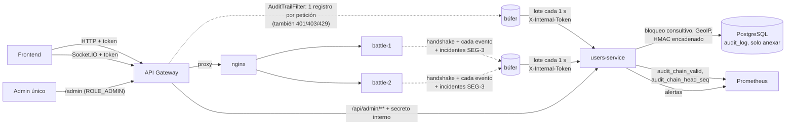
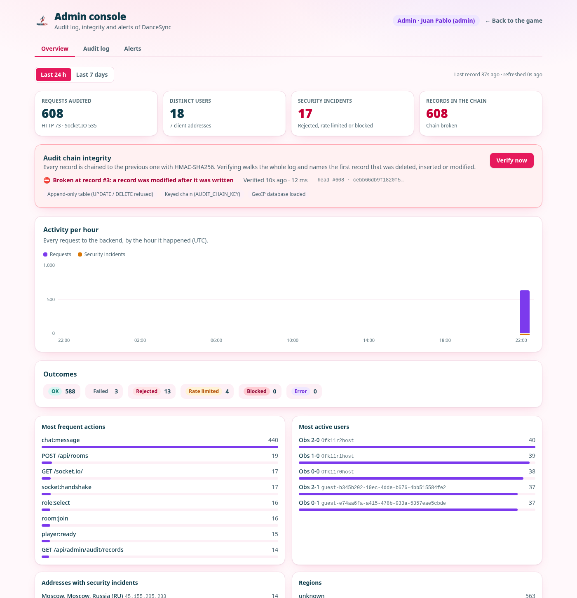
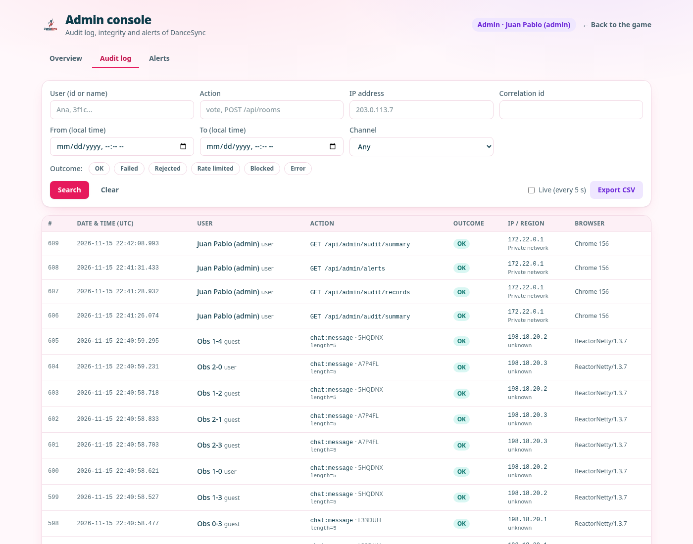
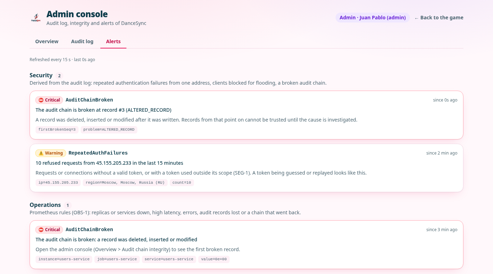

# SEG-2: Seguridad, no repudio

Implementación y evidencia del escenario de calidad SEG-2 de DanceSync (Squad Héroes, Arquitecturas de Software 2026-2).

| | |
|---|---|
| Estado | **Implementado y verificado** con pruebas automatizadas y con una verificación de punta a punta contra el stack en contenedores |
| Repositorios | `DanceSync_BackEnd` (`api-gateway`, `battle-service`, `users-service`) y `DanceSync_FrontEnd`, rama `feat/seg2-audit` |
| Decisión | [ADR-09: registro de auditoría encadenado y de solo anexar, con un único administrador](../adr/ADR-09-auditoria-encadenada.md) |
| Depende de | SEG-1 (la identidad sale del token), OBS-1 (identificador de correlación, Prometheus) |

## Contenido

1. [El escenario y cómo se cumple](#1-el-escenario-y-cómo-se-cumple)
2. [Cómo funciona](#2-cómo-funciona)
3. [El registro](#3-el-registro)
4. [La cadena de hashes](#4-la-cadena-de-hashes)
5. [El panel de administración](#5-el-panel-de-administración)
6. [Alertas](#6-alertas)
7. [Configuración](#7-configuración)
8. [Verificación y evidencia](#8-verificación-y-evidencia)
9. [Qué cambió en cada componente](#9-qué-cambió-en-cada-componente)
10. [Límites conocidos](#10-límites-conocidos)

## 1. El escenario y cómo se cumple

| Lo que pide SEG-2 | Cómo se cumple | Dónde se prueba |
|---|---|---|
| Por cada petición al Back se guarda un registro con **usuario** (del token), **IP** de origen, **fecha y hora** (UTC, del servidor), **región** (GeoIP) y **navegador** (User-Agent) | El gateway registra cada petición HTTP y el Battle Service cada handshake y cada evento de Socket.IO. El usuario es siempre el del token validado (SEG-1); la IP sale de `X-Forwarded-For` contando solo proxies de confianza; la hora la pone el servidor que atiende; users-service resuelve la región con una base GeoIP local | `Seg2AuditTests` (gateway), `seg2.audit.socket.test.ts` (Battle Service), `seg2-verify.mjs` |
| El registro incluye la **acción** y el **identificador de correlación** | `action` (`POST /api/rooms`, `vote:cast`, `socket:handshake`...), `outcome`, código de error o motivo del rechazo, `correlationId` y un `detail` con los hechos que prueban lo que se hizo (a quién votó, a quién expulsó, qué palabra escribió) | Las mismas suites |
| Se **encadena con el hash del anterior** y **no puede modificarse ni borrarse** | users-service es el único escritor: `hash = HMAC-SHA256(clave, prev_hash ‖ registro)`, secuencia sin huecos bajo un bloqueo de PostgreSQL. Triggers rechazan `UPDATE`, `DELETE` y `TRUNCATE` | `AuditChainTest`, `AuditLogPostgresTest` |
| El **100 %** de las peticiones al Back queda registrado con los 5 campos | Un registro por petición HTTP (también las rechazadas con 401/403/429), por handshake (aceptado o rechazado) y por evento. Envío por lotes con reintentos e idempotencia; solo un búfer lleno pierde registros, y eso se cuenta y alerta | "100 % of the events are recorded", `seg2-verify.mjs` (9 de 9) |
| **Cualquier registro alterado o eliminado se detecta** al verificar la cadena | La verificación recorre toda la cadena y nombra el primer registro roto: `MISSING_RECORD`, `BROKEN_LINK`, `ALTERED_RECORD` o `TRUNCATED` | `AuditChainTest` (11 casos), `AuditLogPostgresTest` (fila cambiada o borrada saltándose los triggers), `seg2-verify.mjs` |
| Toda acción se **atribuye a su usuario en menos de 1 minuto** | Los productores envían cada segundo; el admin busca por correlación, usuario o IP | `seg2-verify.mjs`: **máximo 1,2 s** |
| Los registros se **conservan al menos 90 días** | No hay purga ni borrado posible: la tabla es de solo anexar y vive en el volumen persistente de PostgreSQL | `theDatabaseRefusesUpdatesDeletesAndTruncates` |
| Logs y alertas en un apartado de un **usuario único tipo admin** (pedido del equipo) | `ADMIN_USER_OID`: el `oid` de Entra ID de una sola cuenta recibe `ROLE_ADMIN`; solo ella llega a `/api/admin/**` y a la pantalla `/admin` del frontend | `Seg2AuditTests`, `RequireAdmin.test.tsx` |

## 2. Cómo funciona



- **Fuera del camino de la petición.** Registrar solo encola en memoria; un hilo (gateway) o un temporizador (Battle Service) envía el lote. Una caída de users-service nunca frena ni rechaza una petición: los lotes esperan y se reintentan con espera creciente (hasta 30 s).
- **Idempotente.** Cada registro lleva un `eventId` generado por el productor; si un lote se reenvía (no llegó la respuesta), users-service descarta los que ya tiene.
- **Un solo escritor de la cadena.** Varias réplicas y varias instancias de users-service pueden enviar y recibir a la vez: el bloqueo `pg_advisory_xact_lock` serializa la lectura de la cabeza y la escritura de los sucesores.

## 3. El registro

| Campo | De dónde sale |
|---|---|
| `userId`, `userKind`, `userName` | Del token validado: `oid` de Entra ID (usuario) o `sub` del token de invitado; `anonymous` si no hubo token válido. Nunca de un identificador enviado por el cliente |
| `ip` | `X-Forwarded-For`, contando `TRUSTED_PROXY_HOPS` proxies desde la derecha (la misma regla de SEG-3); lo que el cliente escriba más a la izquierda se ignora |
| `occurredAt` | Reloj UTC del servidor que atendió la petición, al milisegundo |
| `region` | Base GeoIP local (DB-IP Lite, formato MaxMind) en users-service: `Ciudad, Región, País (CC)`; `Private network` para direcciones privadas; `unknown` si la base no la ubica. Ninguna dirección sale a un tercero |
| `userAgent` | Cabecera `User-Agent` (hasta 512 caracteres) |
| `action`, `resource`, `channel` | `POST /api/rooms` y la ruta (HTTP), o el evento y la sala (Socket.IO) |
| `outcome`, `status`, `code` | `ok`, `failed`, `rejected` (401/403, `UNAUTHORIZED`/`FORBIDDEN`), `rate_limited` (429, SEG-3), `blocked`, `error`; el motivo (`missing_token`, `expired_token`, `not_admin`, `PLAYER_NOT_IN_ROOM`...) |
| `detail` | Hechos seguros del evento: `dancerId=` (voto), `playerId=` (expulsión), `role=`, `songId=`, `roundId= word=` (Word Race), `length=` (chat: nunca el texto) |
| `correlationId`, `source`, `eventId` | El identificador de OBS-1, el servicio y la réplica, y el id del evento |
| `seq`, `recordedAt`, `prevHash`, `hash` | Posición en la cadena, cuándo se encadenó y los hashes |

Nunca se registran el token, el cuerpo de la petición, la cadena de consulta ni el contenido del chat.

**Qué no se registra a propósito.** Las peticiones de *preflight* CORS (las manda el navegador solo) y las sondas de salud del actuator. Los eventos descartados por el límite de SEG-3 se registran **uno por incidente** (con el número de descartados), no uno por evento: si cada evento de una inundación de 200/s fuera un registro, el ataque se trasladaría al registro de auditoría.

## 4. La cadena de hashes

- **Forma canónica**: cada campo como `<longitud>:<valor>;` (`-1:;` para nulo), en un orden fijo y con versión (`v1`). Ningún valor puede "correrse" al vecino y producir los mismos bytes.
- **Hash**: HMAC-SHA256 con `AUDIT_CHAIN_KEY` (fuera de la base de datos). Sin clave, SHA-256: detecta cualquier cambio hecho sin recalcular la cadena, pero quien tenga escritura en la base podría reconstruirla.
- **Lo que se lee es lo que se hashea**: un registro leído de la base se verifica tal cual está guardado; hasta un espacio de más o un microsegundo distinto lo delatan (`evenATrailingSpaceInAStoredValueIsDetected`, `aTimestampMovedByAMicrosecondIsFound`).
- **Solo anexar**: triggers `BEFORE UPDATE OR DELETE` y `BEFORE TRUNCATE` rechazan la operación incluso al usuario de la aplicación.
- **Verificación**: en segundo plano cada `AUDIT_VERIFY_INTERVAL` (5 min) y bajo demanda desde el panel. Recorre la tabla con un cursor (no la carga en memoria) y reporta:

| Problema | Qué significa |
|---|---|
| `MISSING_RECORD` | Falta un número de secuencia: se borró un registro |
| `BROKEN_LINK` | El registro no apunta al hash del anterior: se borró, insertó o reordenó |
| `ALTERED_RECORD` | El contenido ya no coincide con su hash: se modificó |
| `TRUNCATED` | La cadena termina antes de un registro que esta instancia ya vio: se borró la cola |

- **Anclas fuera de la base**: cada verificación escribe una línea `audit.checkpoint` (cabeza y hash) en el recolector de logs, y Prometheus guarda la serie `audit_chain_head_seq`; la alerta `AuditChainShrunk` salta si la cabeza retrocede.

## 5. El panel de administración

Ruta `/admin` del frontend. Solo la abre la cuenta de `ADMIN_USER_OID`: el frontend pregunta al gateway quién es el usuario (`GET /api/me`, que responde 200 con `admin: true|false` a cualquier sesión, así que entrar a la app nunca queda como un intento de abrir el panel), y el gateway responde 403 en `/api/admin/**` a cualquier otra cuenta (eso sí queda registrado como `rejected / not_admin`). El enlace "Admin console" aparece en el inicio solo para esa cuenta. Cada consulta del admin queda, a su vez, en el registro de auditoría.

**Resumen.** Peticiones auditadas (HTTP y Socket.IO), usuarios distintos, incidentes de seguridad, registros en la cadena; la **integridad de la cadena** con el botón "Verify now" (y el primer registro roto, si lo hay); actividad por hora con incidentes (24 h o 7 días); resultados; acciones más frecuentes, usuarios más activos, direcciones con incidentes y regiones. Cada elemento de las listas lleva a sus registros.



**Registro de auditoría.** Filtros por usuario (id o nombre), acción, IP, identificador de correlación, rango de fechas, canal y resultado; tabla con los 5 campos; detalle de cada registro con todos sus campos y sus hashes, y atajos "misma correlación", "todas las acciones de este usuario", "todo desde esta dirección"; modo en vivo (cada 5 s); exportación CSV con los campos de la cadena (protegida contra inyección de fórmulas).



**Alertas.** Las de seguridad derivadas del registro y las operativas de Prometheus (OBS-1), con severidad (icono y texto, nunca solo color), desde cuándo y su contexto. Se refresca cada 15 s.



API (por el gateway): `GET /api/me` (cualquier sesión: quién soy y si soy el admin); solo admin: `GET /api/admin/session`, `GET /api/admin/audit/records`, `GET /api/admin/audit/records/{seq}`, `GET /api/admin/audit/summary?hours=`, `POST /api/admin/audit/verify`, `GET /api/admin/alerts`.

## 6. Alertas

| Alerta | Origen | Cuándo |
|---|---|---|
| `AuditChainBroken` | Registro (panel) y Prometheus (`audit_chain_valid == 0`) | La última verificación encontró un registro borrado, insertado o modificado |
| `AuditChainShrunk` | Prometheus | `audit_chain_head_seq` bajó respecto a la última hora: se borró la cola |
| `AuditRecordsDropped` | Prometheus | Un productor descartó registros porque su búfer se llenó |
| `AuditDeliveryStalled` | Prometheus | Registros esperando en el gateway más de un minuto |
| `RepeatedAuthFailures` | Registro | Una IP con 10 o más peticiones o conexiones **sin token válido** (401 / `UNAUTHORIZED`: ausente, vencido, manipulado, de otro emisor o audiencia) en 15 min (crítica desde 50). Los 403 de tokens válidos sin permiso (un usuario que no es el admin, un invitado fuera de su sala) quedan registrados pero no cuentan: muchos usuarios legítimos detrás de una misma IP no deben parecer un ataque |
| `ClientBlocked` | Registro | Un cliente bloqueado por inundar (SEG-3) en la última hora |
| Las de OBS-1 | Prometheus | Réplica o servicio caído, latencia alta, errores |

## 7. Configuración

| Variable | Servicio | Uso |
|---|---|---|
| `AUDIT_INTERNAL_TOKEN` | gateway, battle-service, users-service | Secreto compartido (≥ 32 bytes) de los lotes y de las rutas de admin. Vacío: los registros esperan en memoria y el panel responde 503 |
| `ADMIN_USER_OID` | gateway | `oid` de la única cuenta admin. Vacío: nadie es admin |
| `AUDIT_CHAIN_KEY` | users-service | Clave HMAC de la cadena (≥ 32 bytes). Vacío: SHA-256 |
| `GEOIP_DB_PATH` | users-service | Base GeoIP (DB-IP City Lite, CC BY 4.0). La imagen Docker la descarga al construirse y la deja en `/app/geoip/dbip-lite.mmdb` (valor por defecto en la imagen); fuera de Docker, `sh scripts/download-geoip.sh` |
| `POSTGRES_SSLMODE` | users-service | `require` en Azure Database for PostgreSQL |
| `PROMETHEUS_URL` | users-service | Para mostrar las alertas operativas en el panel |
| `AUDIT_VERIFY_INTERVAL` | users-service | Verificación en segundo plano (`PT5M`) |
| `GATEWAY_TRUSTED_PROXIES` | gateway | Patrón de Spring Cloud Gateway para conservar `X-Forwarded-For` (por defecto `.*`, ver abajo) |
| `AUDIT_FLUSH_INTERVAL(_MS)`, `AUDIT_BATCH_SIZE`, `AUDIT_BUFFER_CAPACITY`, `AUDIT_ENABLED` | gateway, battle-service | Envío por lotes y búfer acotado |

Para generar los secretos: `openssl rand -base64 48`. En Azure, users-service debe tener ingreso interno: `/internal/**` no lo enruta el gateway y además exige el secreto.

**Corrección en el gateway (afectaba también a SEG-3).** Spring Cloud Gateway 5, sin `trusted-proxies`, **eliminaba** `X-Forwarded-For` de todo lo que reenviaba; con el patrón, conserva solo las entradas que coinciden. Por eso el Battle Service veía a todos los clientes que llegaban por el gateway con la IP del gateway: un bloqueo de SEG-3 los alcanzaba a todos y el registro no tenía la IP del cliente. Ahora se conserva la cadena completa y se agrega la dirección que ve el gateway; el Battle Service y el gateway eligen la entrada del cliente contando saltos de confianza desde la derecha, así que lo que un cliente falsifique más a la izquierda se ignora igual.

## 8. Verificación y evidencia

### Pruebas automatizadas (corren en el pipeline con `./mvnw -B verify` y `pnpm test`)

| Suite | Qué prueba |
|---|---|
| `AuditChainTest` (users-service, 11) | Cadena intacta; campo modificado, espacio de más, registro borrado (en medio y el primero), registro insertado, intercambiados, cola cortada; cadena con clave imposible de reconstruir sin ella; forma canónica sin ambigüedad |
| `AuditLogPostgresTest` (PostgreSQL real, 8) | La base rechaza `UPDATE`/`DELETE`/`TRUNCATE`; **8 escritores concurrentes × 50 registros = una sola cadena sin huecos**; fila cambiada o borrada saltándose los triggers → detectada; filtros y resumen |
| `AuditServiceTest`, `AuditEventTest`, `AdminAlertsServiceTest`, `GeoIpRegionResolverTest`, `AuditEndpointsTest` | Lotes reenviados sin duplicar, cola truncada, normalización, alertas de seguridad, direcciones privadas, nombres de host nunca resueltos por DNS, endpoints protegidos por el secreto |
| `Seg2AuditTests` (gateway, HTTP real, 8) | Registro de una petición autorizada con los 5 campos; rechazada (anónima, `missing_token`); invitado fuera de su sala; *preflight* no registrado; el lote no lleva el token del usuario; solo el admin llega al API de admin y recibe el secreto; un cliente no puede enviar el secreto; el Battle Service recibe la cadena de direcciones del cliente |
| `AuditShipperTests` (gateway, 7) | Lotes, caída de users-service y reintento, lote inválido descartado, búfer lleno sin bloquear |
| `seg2.audit.socket.test.ts` (Battle Service, 8) | Handshake aceptado y rechazado; cada evento con acción, sala, resultado y detalle; el usuario es el del token aunque el cliente diga otro; 100 % de 25 eventos registrados una vez; incidentes de abuso agregados |
| `seg2.auditShipper.test.ts` (Battle Service, 8) | Sello de tiempo y `eventId`, reintentos con el mismo `eventId`, búfer acotado, cierre ordenado, configuración, detalle seguro |
| Frontend (`AdminPage`, `RequireAdmin`, `format`, `HomePage`, 21) | Las tres pestañas, verificación bajo demanda, detalle con hashes, filtros, acceso solo del admin, CSV seguro |

Totales tras el cambio: users-service 92, api-gateway 68 (3 omitidas que requieren Redis), battle-service 364 (1 omitida previa), frontend 223. Cobertura del frontend: 78,5 % de líneas.

### Verificación de punta a punta

`load-tests/scripts/seg2-verify.mjs` hace exactamente lo que pide "Cómo se verifica", contra `docker-compose.observability.yml` (gateway, nginx, 2 réplicas, Redis, users-service, PostgreSQL, Prometheus):

```sh
sh scripts/download-geoip.sh                       # opcional: región real
docker compose -f docker-compose.observability.yml up -d --build
cd load-tests && npm install && node scripts/seg2-verify.mjs
```

Resultado ([reporte](../../load-tests/reports/seg2-verify-2026-11-15T22-39-46.md)): **PASA**.

| Medida | Meta | Resultado |
|---|---|---|
| Peticiones registradas (HTTP y Socket.IO, aceptadas y rechazadas) | 100 % | **9 de 9** |
| Registros con los 5 campos correctos (IP y navegador conocidos) | 100 % | **9 de 9**, región resuelta (p. ej. `Mountain View, California, United States (US)`) |
| Atribución: de la acción al registro consultable por el admin | < 1 min | **máx 1,2 s**, promedio 1,0 s |
| `UPDATE` / `DELETE` como usuario de la aplicación | Rechazado | **Rechazados** por el trigger |
| Registro modificado saltándose los triggers | Detectado | **Detectado**: `ALTERED_RECORD` en el registro #3 |
| Alerta visible para el admin tras la manipulación | — | Seguridad a los **154 ms**; `AuditChainBroken` de Prometheus a los **3,3 s** |

## 9. Qué cambió en cada componente

| Componente | Cambios |
|---|---|
| users-service | Tabla `audit_log` (V3) con triggers de solo anexar; dominio `AuditEvent`/`AuditRecord`/`AuditChain`; `AuditService` (escritor único, consultas, verificación); `AdminAlertsService`; adaptador JDBC; GeoIP local; cliente de alertas de Prometheus; `POST /internal/audit/events`; API `/api/admin/**`; `InternalTokenFilter`; verificación periódica con métricas y *checkpoints* |
| api-gateway | `AuditTrailFilter` + captura de identidad dentro de la cadena de seguridad; `AuditShipper`; rol `ROLE_ADMIN` para `ADMIN_USER_OID`; ruta `users-service-admin`; `InternalTokenRelay`; motivo `not_admin`; `trusted-proxies` |
| battle-service | Puerto `AuditTrail`; `HttpAuditShipper`; registro en el handshake, en cada evento (`guard`) y en los incidentes de SEG-3; métrica `dancesync_audit_records_total` |
| Frontend | `features/admin`: API, control de acceso, `RequireAdmin`, `AdminPage` (resumen, registro, alertas), gráfica de actividad; enlace en el inicio |
| Observabilidad | Grupo de reglas `dancesync-audit` en Prometheus; configuración en `docker-compose.observability.yml` |
| Documentación | Este documento, ADR-09, README, `.env.example`, `scripts/download-geoip.sh` |

## 10. Límites conocidos

- **Muerte abrupta de un productor.** Con `SIGKILL` se pierde lo que tenía en cola (≤ 1 s de registros); con `SIGTERM` (despliegue, escalado) lo entrega antes de salir. Una cola durable (Redis Streams) lo cerraría, a costa de exigir Redis en el gateway y en desarrollo local.
- **Borrado de la cola por un superusuario.** Dentro de la base solo se detecta contra lo que esta instancia ya había visto; fuera, con los *checkpoints* del recolector de logs y la alerta `AuditChainShrunk`.
- **Cuenta admin.** Se identifica por `oid`; si esa cuenta se compromete, el atacante ve el registro (no puede alterarlo: el API de admin es de solo lectura y la base rechaza cambios).
- **Crecimiento.** La tabla no se purga. Archivar requerirá un procedimiento que conserve el último hash como ancla de la cadena siguiente.
- **`TRUSTED_PROXY_HOPS` en Azure.** Igual que en SEG-3, hay que confirmarlo mirando las cabeceras reales del despliegue; con un valor menor, todos los clientes compartirían la IP del proxy.
