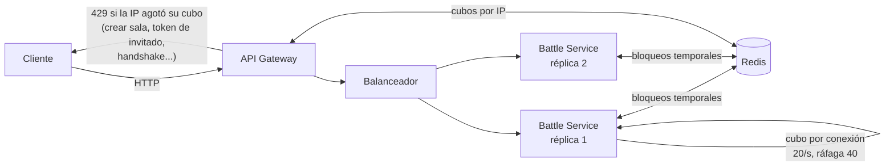

# SEG-3: Protección ante abuso o denegación de servicio

Implementación y evidencia del escenario de calidad SEG-3 de DanceSync (Squad Héroes, Arquitecturas de Software 2026-2).

| | |
|---|---|
| Estado | **Implementado y verificado** con pruebas automatizadas y una prueba de carga con clientes abusivos en el prototipo local. La variación del p95 de los usuarios normales quedó dentro del ruido de la medición (ver [sección 7](#7-análisis-de-los-resultados)) |
| Repositorios | `DanceSync_BackEnd` (`battle-service`, `api-gateway`, `load-tests`) y `DanceSync_FrontEnd`, rama `feat/seg3-dos` |
| Alcance | Lo que pide SEG-3. Se apoya en el Redis y el entorno de escala de [REN-1](REN-1-rendimiento-latencia.md) |
| Decisión | [ADR-05: límite de eventos en el Battle Service y límite HTTP en el gateway](../adr/ADR-05-limite-eventos-y-http.md) |

## Contenido

1. [El escenario y cómo se cumple](#1-el-escenario-y-cómo-se-cumple)
2. [Cómo funciona](#2-cómo-funciona)
3. [Decisiones de diseño](#3-decisiones-de-diseño)
4. [Qué cambió en cada componente](#4-qué-cambió-en-cada-componente)
5. [Configuración](#5-configuración)
6. [Verificación y evidencia](#6-verificación-y-evidencia)
7. [Análisis de los resultados](#7-análisis-de-los-resultados)
8. [Registro de incidentes](#8-registro-de-incidentes)
9. [Estado actual del escenario](#9-estado-actual-del-escenario)
10. [Lo que queda pendiente](#lo-que-queda-pendiente)

## 1. El escenario y cómo se cumple

| Lo que pide SEG-3 | Cómo se cumple | Evidencia |
|---|---|---|
| El Battle Service mide los eventos de cada conexión con un cubo de fichas: 20 por segundo sostenidos y ráfagas de hasta 40 | Middleware de Socket.IO (`socket.use`) que corre antes de cualquier manejador de eventos. Un evento sin ficha nunca llega a los casos de uso | `tokenBucket.test.ts`, `eventRateLimit.socket.test.ts` |
| Descarta los eventos sobrantes y avisa con `rate:limited` | El evento rechazado se descarta; si esperaba respuesta, se responde al instante con `RATE_LIMITED`. `rate:limited` se envía como máximo una vez por segundo | Ídem |
| Si el cliente reincide, se le bloquea 30 s y se cierra la conexión; el bloqueo se guarda en Redis y vale en cualquier réplica | Más de 40 eventos descartados en 10 s bloquean la identidad del token **y** la dirección IP 30 s (Redis). La conexión recibe `rate:blocked` y se cierra. El handshake rechaza con `BLOCKED` a quien está bloqueado | `abuseProtection.socket.test.ts` (incluida una prueba con dos instancias y un Redis) |
| El gateway limita las peticiones HTTP por origen (creación de salas, handshake) y responde 429 | Cubo de fichas por IP y por tipo de petición en la cadena de seguridad, antes de la autenticación. 429 con `Retry-After`. Contadores en Redis | `Seg3RateLimitTests` y pruebas unitarias del gateway |
| Se registra cada incidente | Líneas JSON `abuse.rate_limited`, `abuse.blocked` y `abuse.refused` con `correlationId`, jugador e IP, en el mismo formato que la auditoría de SEG-1 | [Sección 8](#8-registro-de-incidentes) |
| El cliente abusivo es limitado en menos de 1 s | **Primer descarte a los 369 ms de mediana y 422 ms en el peor caso**; bloqueo a los 700 ms de mediana | Prueba de carga `abuse` |
| La latencia p95 de los demás usuarios no aumenta más de un 5 % durante el ataque | **Dentro del ruido de la medición.** Contra la peor de dos corridas sin ataque, +1,5 % como máximo; pero entre esas dos corridas el p95 ya varía hasta un 25 %, así que la medición no puede confirmar ni descartar un efecto del 5 %. Los usuarios normales tuvieron 0 errores | Prueba de carga `abuse` y dos corridas `nominal` |
| Se prueba con 140 usuarios normales más 5 clientes abusivos a 200 eventos por segundo | `load-tests/scenarios/abuse.yml`: las 20 salas de REN-1 y, a los 240 s, 5 abusivos durante 5 minutos que insisten al ser bloqueados | Prueba de carga `abuse` |

### Tácticas aplicadas

| Táctica (libro) | Cómo se aplica |
|---|---|
| Detectar ataques: detectar denegación de servicio | El cubo de fichas mide la tasa de eventos de cada conexión y la tasa de peticiones HTTP de cada IP |
| Resistir ataques: limitar el acceso | Los eventos y peticiones que sobran se descartan (Battle Service) o se responden con 429 (gateway) antes de consumir recursos |
| Reaccionar ante ataques: revocar el acceso | Bloqueo temporal de la identidad y la IP, compartido entre réplicas por Redis, y cierre de la conexión |
| Reaccionar ante ataques: informar a los actores | El cliente recibe `rate:limited`, `rate:blocked`, `BLOCKED` o 429 con el tiempo de espera, y el frontend se lo muestra al usuario. Cada incidente queda en el registro |

## 2. Cómo funciona



**Los dos límites se complementan.** El gateway solo ve peticiones HTTP: una vez abierta la conexión de Socket.IO, la conexión pasa por él sin que pueda contar sus eventos. Por eso cada capa limita lo que ve (ADR-05):

| Capa | Qué limita | Por quién | Cuando se excede |
|---|---|---|---|
| API Gateway | Crear sala, token de invitado, abrir conexiones (handshake), long-polling y el resto de peticiones HTTP | IP del cliente | `429 Too Many Requests` con `Retry-After`, antes de verificar el token |
| Battle Service | Eventos de una conexión abierta (chat, votos, palabras, señalización...) | Conexión | Descarte, `RATE_LIMITED` en la respuesta y `rate:limited` |
| Battle Service | Reincidencia: más de 40 eventos descartados en 10 s | Identidad del token e IP | Bloqueo de 30 s en Redis, `rate:blocked`, cierre de la conexión y `BLOCKED` en cada handshake mientras dure |

**Qué ve el usuario (frontend).** Un aviso amarillo cuando el servidor descarta algunos de sus eventos ("You are going too fast..."), un aviso rojo con cuenta regresiva mientras está bloqueado ("You can continue in N s"), y el tiempo de espera cuando el gateway responde 429. Durante el bloqueo el cliente no envía nada y se reconecta solo al terminar: Socket.IO no reintenta una conexión que el servidor cerró a propósito.

## 3. Decisiones de diseño

- **Cubo de fichas, no ventana fija.** La ráfaga de 40 absorbe picos legítimos (todas las acciones de una ronda que se abre) y la tasa sostenida de 20 frena una inundación en una fracción de segundo.
- **Limitar antes de trabajar.** En el Battle Service, el middleware corre antes de cualquier manejador: un evento rechazado no toca la sala ni Redis. En el gateway, el filtro va antes de la autenticación: una inundación con tokens falsos se corta sin verificar firmas ni escribir una línea de auditoría por petición.
- **Responder al instante.** Un evento rechazado que esperaba respuesta recibe `RATE_LIMITED` de inmediato, para que un cliente legítimo no espere el tiempo máximo de 8 s.
- **Avisar sin amplificar.** `rate:limited` y las líneas del registro se agrupan: como máximo una por segundo y por conexión (o por IP en el gateway). Responder a cada evento de una inundación con otro mensaje ayudaría al atacante.
- **Bloquear identidad e IP.** Bloquear solo la identidad se esquiva pidiendo otro token de invitado; bloquear solo la IP castigaría a quien cambia de red. Se bloquean las dos.
- **"Reincidir" = más de 40 descartes en 10 s.** El documento no lo precisa. Un cliente legítimo que se excede un momento pierde unos pocos eventos y no llega; el bot del escenario lo supera en menos de un segundo.
- **IP real solo de proxies de confianza.** La IP sale de `X-Forwarded-For` contando únicamente las entradas que agregaron los proxies configurados (`TRUSTED_PROXY_HOPS`); lo que el cliente escriba ahí se ignora. Misma regla en el Battle Service (`clientAddress.ts`) y en el gateway (`ClientAddress.java`), reutilizable por el escenario de no repudio.
- **Si Redis falla, se deja pasar.** Una caída de Redis no debe dejar a todos por fuera: el gateway deja pasar las peticiones y el Battle Service acepta conexiones, registrando el error. Al bot que inunda se le cierra la conexión igual.
- **CORS también en el 429.** El límite del gateway va después del CORS, así que el navegador puede leer el 429 y el frontend mostrar el tiempo de espera.

## 4. Qué cambió en cada componente

### battle-service

| Archivo | Qué hace |
|---|---|
| `infrastructure/abuse/TokenBucket.ts` | Cubo de fichas con reloj inyectable |
| `infrastructure/abuse/eventRateLimit.ts` | Middleware por conexión: descarte, `RATE_LIMITED`, `rate:limited` |
| `infrastructure/abuse/abuseProtection.ts` | Bloqueo por reincidencia, rechazo en el handshake, `rate:blocked`, registro de incidentes |
| `infrastructure/abuse/blockList.ts`, `redis/RedisBlockList.ts` | Lista de bloqueos en memoria y en Redis (claves que expiran solas) |
| `infrastructure/abuse/clientAddress.ts` | IP real del cliente detrás de proxies de confianza |
| `infrastructure/abuse/abuseAudit.ts` | Líneas `abuse.rate_limited`, `abuse.blocked`, `abuse.refused` |
| `infrastructure/abuse/abuseConfig.ts` | Configuración validada al arrancar |
| `redis/stateStores.ts`, `ws/events.ts`, `server.ts` | Lista de bloqueos según `REDIS_URL`, tipos de los eventos nuevos y una línea de armado después de la autenticación de SEG-1 |
| `test/tokenBucket.test.ts`, `abuseConfig.test.ts`, `clientAddress.test.ts`, `blockList.contract.test.ts`, `eventRateLimit.socket.test.ts`, `abuseProtection.socket.test.ts` | Pruebas de SEG-3 |

`socketHandlers.ts`, el archivo de SEG-1, no se modificó.

### api-gateway

| Archivo | Qué hace |
|---|---|
| `ratelimit/HttpRateLimiter.java` | Filtro de límite: política por tipo de petición, 429, registro |
| `ratelimit/TokenBucketStore.java`, `InMemoryTokenBucketStore.java`, `RedisTokenBucketStore.java` | Cubos en memoria o en Redis (un script Lua atómico que usa el reloj de Redis) |
| `ratelimit/ClientAddress.java`, `RateLimitProperties.java`, `RateLimitConfig.java` | IP real, propiedades `dancesync.rate-limit` y elección del almacén |
| `security/SecurityConfig.java` | Una línea: el filtro entra en la cadena de seguridad después del CORS y antes de la autenticación |
| `pom.xml`, `application.yml` | Dependencia `lettuce-core` y configuración |
| `Seg3RateLimitTests.java` y pruebas de `ratelimit/` | Pruebas de SEG-3. Las suites de SEG-1 corren con el límite desactivado (`src/test/resources/application.properties`) |

### Frontend

| Archivo | Qué hace |
|---|---|
| `shared/lib/socket.ts` | Maneja `rate:limited`, `rate:blocked` y `BLOCKED`; no envía nada durante un bloqueo y se reconecta al terminar |
| `shared/lib/connectionStatus.ts` | Estado `blocked`, fin del bloqueo y aviso de "más despacio" |
| `shared/ui/molecules/ConnectionBanner.tsx` | Avisos al usuario, con cuenta regresiva |
| `shared/api/httpClient.ts`, `pages/LoginPage.tsx` | `RateLimitedError` para el 429, con el tiempo de espera |

### Pruebas de carga y pipeline

| Archivo | Qué hace |
|---|---|
| `load-tests/lib/room-bot.cjs` | Cliente abusivo, IP simulada por sala y registro aparte del tramo 245-540 s |
| `load-tests/scenarios/abuse.yml`, `abuse-smoke.yml` | Escenario del documento y versión corta |
| `load-tests/scripts/abuse-compare.mjs`, `summary.mjs` | Comparación con y sin ataque, y resumen de los abusivos |
| `docker-compose.scale.yml` | `TRUSTED_PROXY_HOPS=2` en las réplicas |
| `.github/workflows/backend-ci.yml` | Redis para las pruebas del gateway |

## 5. Configuración

### Battle Service

| Variable | Por defecto | Descripción |
|---|---|---|
| `RATE_LIMIT_EVENTS_PER_SECOND` | `20` | Tasa sostenida de eventos por conexión |
| `RATE_LIMIT_EVENT_BURST` | `40` | Ráfaga máxima |
| `RATE_LIMIT_STRIKE_THRESHOLD` / `RATE_LIMIT_STRIKE_WINDOW_SECONDS` | `40` / `10` | Más de 40 eventos descartados en 10 s bloquean al cliente |
| `RATE_LIMIT_BLOCK_SECONDS` | `30` | Duración del bloqueo |
| `TRUSTED_PROXY_HOPS` | `0` | Proxies delante del servicio cuya entrada de `X-Forwarded-For` se cree. `0`: se usa la dirección de la conexión |

Con `REDIS_URL` (de REN-1) los bloqueos se comparten entre réplicas.

### API Gateway

| Variable | Por defecto | Descripción |
|---|---|---|
| `RATE_LIMIT_ENABLED` | `true` | Activa el límite |
| `TRUSTED_PROXY_HOPS` | `0` | Igual que en el Battle Service |
| `REDIS_URL` | vacía | Cubos compartidos entre instancias del gateway; vacía, en memoria |
| `RATE_LIMIT_<POLÍTICA>_PER_SECOND` / `_BURST` | ver abajo | Una pareja por política |

| Política | Por segundo | Ráfaga |
|---|---|---|
| `ROOM_CREATE` (`POST /api/rooms`) | 1 | 10 |
| `GUEST_TOKEN` (`POST /api/rooms/{code}/guest-token`) | 5 | 20 |
| `SOCKET_HANDSHAKE` (abrir una conexión) | 5 | 30 |
| `SOCKET_POLLING` (sesión de long-polling abierta) | 20 | 40 |
| `OTHER` (el resto) | 20 | 40 |

Estos valores no están en el documento de escenarios: se eligieron holgados para un grupo que entra desde la misma red, y se ajustan por variables de entorno. Las peticiones `OPTIONS` y los chequeos de salud nunca se limitan.

## 6. Verificación y evidencia

### Pruebas automatizadas

| Suite | Resultado |
|---|---|
| `battle-service`, sin Redis (`pnpm test`) | 310 pruebas, 310 pasan (33 nuevas de SEG-3) |
| `battle-service`, con Redis (`TEST_REDIS_URL=... pnpm test`) | 335 pruebas, 335 pasan |
| `api-gateway` (`./mvnw -B verify`) | `BUILD SUCCESS` (20 pruebas nuevas de SEG-3; las 3 del almacén en Redis corren con `TEST_REDIS_URL`) |
| Frontend (`pnpm test`) | 198 pruebas, 198 pasan (11 nuevas) |

Cada parte tiene un control negativo: al desactivar el límite, el bloqueo o el rechazo en el handshake, fallan exactamente las pruebas que dependen de ello. Entre las pruebas del Battle Service hay una con dos instancias que comparten un Redis: un cliente bloqueado por una es rechazado por la otra.

### Prueba de carga

| | |
|---|---|
| Entorno | `docker-compose.scale.yml`: 2 réplicas del Battle Service (0,5 CPU y 512 MB cada una), Redis 7 y nginx, con la protección de SEG-3 activa. Máquina: i7-6700T, 32 GB, Windows con Docker Desktop |
| Usuarios normales | 20 salas de 7 (140 usuarios), 1 evento cada 2 s por usuario, cada sala con su propia IP simulada |
| Clientes abusivos | 5, cada uno con su IP. A los 240 s crean su sala y envían 200 eventos de chat por segundo durante 5 minutos. Al ser bloqueados intentan reconectarse cada segundo, y una vez con un token de invitado nuevo desde la misma IP |
| Generador | Artillery, sano en todas las corridas (retraso del bucle de eventos p95 = 12 ms) |
| Ruta | Las pruebas entran por el balanceador; el límite del gateway no estuvo en el camino (está verificado por sus pruebas automatizadas) |

**Clientes abusivos** (corrida `abuse`):

| Métrica | Resultado | Criterio |
|---|---|---|
| Inicio de la inundación → primer `rate:limited` | mediana 369 ms, p95 392 ms, **máximo 422 ms** (50 conexiones) | < 1 s |
| Inicio de la inundación → bloqueo | mediana 699 ms, p95 743 ms, máximo 854 ms | |
| Conexiones abusivas que terminaron bloqueadas | **50 de 50** | |
| Reconexiones rechazadas mientras duraba el bloqueo | 1.434 | |
| Token de invitado nuevo desde una IP bloqueada | rechazado 5 de 5 | |
| Eventos que los abusivos llegaron a enviar | 4.756 (de 300.000 que intentarían 5 bots a 200 por segundo durante 5 minutos) | |

**Usuarios normales**, tres corridas en el mismo entorno, una después de la otra:

| | Sin ataque (A) | Sin ataque (B) | Con ataque |
|---|---|---|---|
| p95 chat, toda la corrida | 23,3 ms | 19,1 ms | 21,5 ms |
| p95 voto, toda la corrida | 38,5 ms | 32,8 ms | 32,8 ms |
| Errores | 0 | 0 | **0** |
| Batallas / rondas | 140 / 420 | 140 / 420 | 140 / 420 |
| Fines duplicados, ganadores distintos, puntajes inconsistentes | 0 / 0 / 0 | 0 / 0 / 0 | **0 / 0 / 0** |

**El criterio del 5 %, en el mismo tramo de cada prueba** (del segundo 245 al 540, que en la corrida con ataque cae dentro del ataque):

| p95 en ms (aproximado) | Base A | Base B | Con ataque | Ataque vs base A | Ataque vs base B | Base B vs base A (ruido) |
|---|---|---|---|---|---|---|
| Chat | 23,3 | 29,1 | 28,8 | +23,9 % | −1,0 % | +25,2 % |
| Voto | 37,3 | 40,8 | 37,7 | +1,2 % | −7,5 % | +9,5 % |
| Acuse | 31,4 | 35,4 | 36,0 | +14,4 % | +1,5 % | +12,7 % |

Estos p95 son **aproximados**: los reportes no traían el tramo registrado aparte, así que se estimó con los resúmenes de 10 s de Artillery (media de los p95 de cada intervalo ponderada por número de muestras), con el mismo método para los tres. El bot ya registra el tramo en toda corrida (`dancesync.window.*`), de modo que una repetición daría el valor exacto.

### Archivos de evidencia

En [`seg-3/evidence/`](seg-3/evidence/), los reportes de Artillery con sus metadatos (`.meta.json`) y la serie de recursos (`.recursos.csv`):

| Archivo | Prueba |
|---|---|
| `abuse-ataque-2026-11-15T05-26-00.*` | 140 usuarios más 5 abusivos |
| `nominal-base-seg3-a-2026-11-15T05-00-21.*` | Sin ataque, línea base A |
| `nominal-base-seg3-b-2026-11-15T05-13-04.*` | Sin ataque, línea base B |
| `abuse-smoke-humo-abuso-2026-11-15T04-58-04.*` | Prueba corta: 3 salas y 2 abusivos |

Para volver a imprimir el resumen o la comparación (desde `load-tests`):

```bash
node scripts/summary.mjs ../docs/quality/seg-3/evidence/abuse-ataque-2026-11-15T05-26-00.json abuse
node scripts/abuse-compare.mjs ../docs/quality/seg-3/evidence/nominal-base-seg3-a-2026-11-15T05-00-21.json ../docs/quality/seg-3/evidence/abuse-ataque-2026-11-15T05-26-00.json ../docs/quality/seg-3/evidence/nominal-base-seg3-b-2026-11-15T05-13-04.json
```

## 7. Análisis de los resultados

**El abusivo queda limitado muy por debajo de 1 s.** El peor caso de 50 conexiones fue 422 ms, incluida la ida y vuelta por el balanceador. El bloqueo llega cuando se acumulan más de 40 descartes, unos 700 ms después de empezar. Al terminar cada bloqueo de 30 s, el bot volvió a inundar y fue bloqueado otra vez: 50 conexiones aceptadas, 50 bloqueos.

**El ataque casi no llega al servidor.** Cada conexión abusiva alcanza a enviar unos 95 eventos antes de que se cierre; después, durante 30 s, sus reconexiones se rechazan en el handshake, antes de entrar a ninguna sala (1.434 en total, unas 5 por segundo). De los 300.000 eventos que el ataque intentaría enviar en 5 minutos, solo se enviaron 4.756, unos 16 por segundo frente a los ~70 por segundo de los 140 usuarios normales. Y de esos, solo la ráfaga inicial de cada conexión llega a los manejadores.

**El criterio del 5 %: dentro del ruido.** El mismo tramo de dos corridas sin ataque, en el mismo entorno y con la misma carga, difiere hasta un 25 % en el p95 (chat: 23,3 ms en una y 29,1 ms en la otra). Contra la peor de las dos, el p95 con ataque varía +1,5 % como máximo; contra la mejor, hasta +23,9 %, que es casi exactamente la diferencia entre las dos corridas sin ataque. Con una corrida de cada tipo, esta medición no puede confirmar ni descartar un efecto del 5 %: el ruido es cinco veces mayor que el límite. Repetir las corridas para obtener el valor exacto no cambiaría eso, porque el valor exacto seguiría cayendo dentro del mismo ruido. Lo que sí muestran los datos es que el ataque no produjo ningún efecto visible por encima de la variación normal: ningún error, ninguna batalla perdida y la misma latencia de toda la corrida que sin ataque (21,5 ms frente a 23,3 y 19,1 ms).

**Por qué hay tanto ruido.** Con un p95 de unos 20-30 ms, un 5 % es 1 o 2 ms. El generador, las dos réplicas, Redis, nginx y Docker comparten una misma máquina de escritorio, cuyo sistema operativo tiene su propia actividad, y cada corrida tiene sorteos distintos (frases, palabras, canciones, momentos de las rondas). Bajar el ruido por debajo del 5 % exigiría una máquina dedicada para el generador y varias corridas de cada tipo.

**Límites de la medición.**

- Las pruebas de carga entran por el balanceador, no por el API Gateway. El límite HTTP del gateway está verificado por sus pruebas automatizadas, no con carga.
- Los abusivos inundan con eventos de chat. Los demás eventos pasan por el mismo middleware antes de llegar a su manejador, así que el límite es el mismo, pero no se probaron con carga uno por uno.
- El bot abusivo deja de enviar mientras está desconectado; un atacante real que siguiera intentándolo solo conseguiría más rechazos en el handshake, que el gateway también limita por IP.
- Las IP son simuladas con `X-Forwarded-For` y dos proxies de confianza, como se verían detrás del ingreso de la plataforma.

## 8. Registro de incidentes

Cada incidente es una línea JSON en la salida de error, con el mismo formato que la auditoría de SEG-1 (`auth.rejected`):

| Evento | Cuándo | Campos |
|---|---|---|
| `abuse.rate_limited` | Se descartaron eventos de una conexión (máximo una línea por segundo y conexión) | `correlationId`, `playerId`, `ip`, `socketEvent`, `dropped`, `retryAfterMs` |
| `abuse.blocked` | Una conexión reincidió: bloqueo y cierre | `correlationId`, `playerId`, `ip`, `blockedForMs` |
| `abuse.refused` | Un cliente bloqueado intentó conectarse | `correlationId`, `playerId`, `ip`, `socketEvent: "handshake"`, `blockedForMs` (lo que falta) |
| `abuse.rate_limited` (gateway, `channel: "http"`) | Una IP agotó su cubo (máximo una línea por segundo, política e IP) | `policy`, `ip`, `refused`, `correlationId`, `method`, `path` |

Nunca se registran tokens, cabeceras, cuerpos ni el contenido de los eventos.

Fragmento del registro de la réplica 1 durante la corrida con ataque. Los abusivos 1, 3 y 4 intentan reconectarse cada segundo y se les rechaza con el tiempo que les falta de bloqueo, que va bajando:

```json
{"level":"warn","event":"abuse.refused","at":"2026-11-15T05:35:04.550Z","channel":"socket.io","correlationId":"ec0cc701-411f-46d4-907d-d16596b2519c","playerId":"Afl86x3","ip":"198.19.255.4","socketEvent":"handshake","blockedForMs":18831}
{"level":"warn","event":"abuse.refused","at":"2026-11-15T05:35:05.081Z","channel":"socket.io","correlationId":"9b717add-1761-494d-a946-b822b6b50ca7","playerId":"Afl86x1","ip":"198.19.255.2","socketEvent":"handshake","blockedForMs":17663}
{"level":"warn","event":"abuse.refused","at":"2026-11-15T05:35:05.081Z","channel":"socket.io","correlationId":"707b63b0-e2ac-4e76-9664-4a46c7ef1720","playerId":"Afl86x4","ip":"198.19.255.5","socketEvent":"handshake","blockedForMs":19817}
{"level":"warn","event":"abuse.refused","at":"2026-11-15T05:35:05.562Z","channel":"socket.io","correlationId":"0d6d3744-3a66-49e3-9db8-47aa71eb11aa","playerId":"Afl86x3","ip":"198.19.255.4","socketEvent":"handshake","blockedForMs":17820}
{"level":"warn","event":"abuse.refused","at":"2026-11-15T05:35:06.572Z","channel":"socket.io","correlationId":"7d157569-3778-48b5-a0f2-a18c7d6e3d47","playerId":"Afl86x3","ip":"198.19.255.4","socketEvent":"handshake","blockedForMs":16810}
```

Como el bloqueo está en Redis, cualquiera de las réplicas rechaza al abusivo, sin importar cuál lo bloqueó (lo prueba `abuseProtection.socket.test.ts` con dos instancias y un Redis).

## 9. Estado actual del escenario

Texto para la sección "Estado actual" de SEG-3 en el documento de escenarios:

> **Implementado y verificado en el prototipo local.** Cubo de fichas por conexión en el Battle Service (20 eventos por segundo, ráfaga de 40), bloqueo de 30 s por identidad e IP guardado en Redis y válido en todas las réplicas, límite HTTP por IP en el API Gateway con respuesta 429, aviso al usuario en el frontend y registro de cada incidente. Con 140 usuarios normales y 5 clientes abusivos a 200 eventos por segundo, el abusivo fue limitado en 422 ms en el peor caso y bloqueado en las 50 conexiones que abrió; los usuarios normales no tuvieron errores. La variación del p95 de los usuarios normales (+1,5 % contra la peor de dos corridas sin ataque) quedó dentro del ruido de la medición, que entre dos corridas sin ataque llega al 25 %.

## Lo que queda pendiente

**No verificado**

- **Límite del gateway con carga.** Las pruebas de carga entran por el balanceador; el límite HTTP está probado con pruebas automatizadas. Falta una corrida a través del gateway.
- **El criterio del 5 % con una medición más precisa.** Requiere un generador en una máquina dedicada y varias corridas de cada tipo para que el ruido quede por debajo del 5 %.

**Para el despliegue**

- **`TRUSTED_PROXY_HOPS` en Azure.** Depende de cuántos proxies agregan `X-Forwarded-For` delante de cada servicio: el ingreso de Container Apps delante del gateway, y el ingreso más el gateway delante del Battle Service. Con un valor menor, todos los clientes compartirían la IP del proxy y un bloqueo los alcanzaría a todos; con uno mayor, un cliente podría falsificar su IP. Hay que confirmarlo mirando las cabeceras que llegan en el despliegue.
- **`REDIS_URL` en el gateway** para que sus contadores se compartan si tiene más de una instancia.

**Limitaciones conocidas**

- **IP compartida.** Varios usuarios detrás de la misma red (el Wi-Fi de la universidad) comparten IP: si uno de ellos inunda, el bloqueo de 30 s los alcanza a todos, y los límites HTTP del gateway se reparten entre ellos. Es la compensación de bloquear por IP; sin ella, el bloqueo se esquiva pidiendo otro token de invitado.
- **Varias conexiones de un mismo cliente.** El límite de eventos es por conexión: un cliente con varias conexiones tiene un cubo por cada una. El límite de handshakes del gateway (5 por segundo, ráfaga de 30, por IP) acota cuántas puede abrir, y el bloqueo, por identidad e IP, las alcanza a todas.
- **Si Redis falla**, los bloqueos dejan de compartirse y de comprobarse en el handshake, y el gateway deja de limitar. Es intencional: se prefiere seguir atendiendo.
